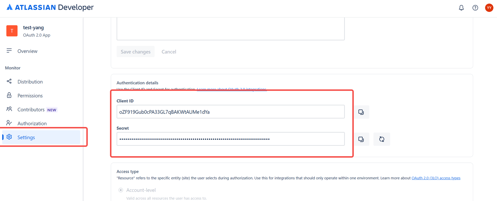
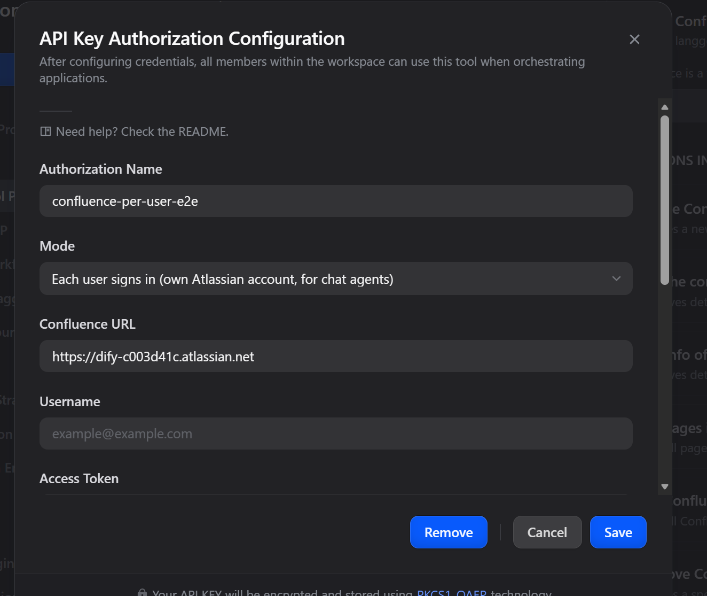
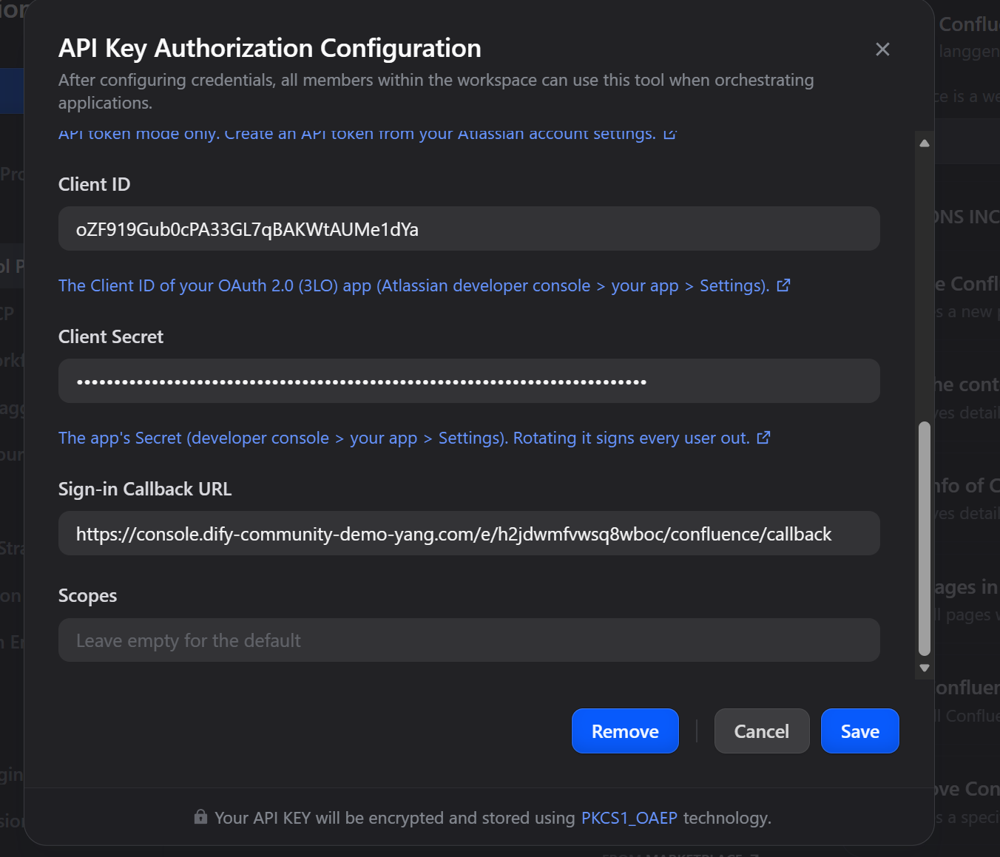
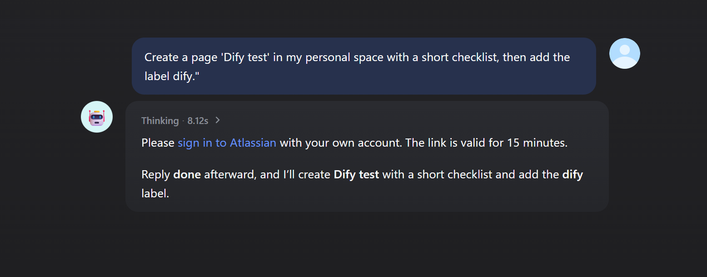
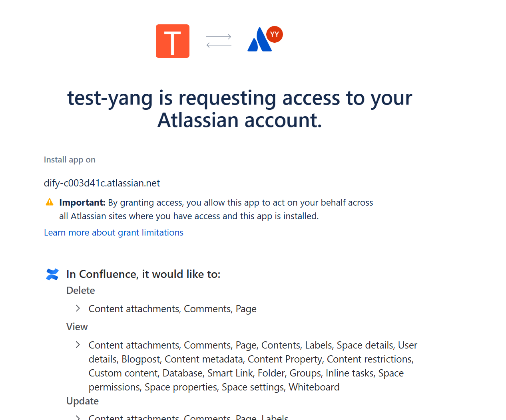
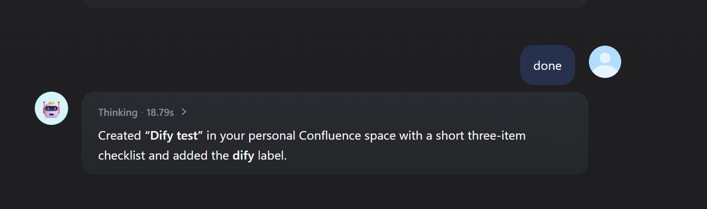

## Dify Plugin for Confluence

Search, read, create and update Confluence pages, and work with their comments, labels, attachments and child pages. Works with Confluence Cloud and Confluence Server / Data Center.

### What's new in 1.0.0

- **OAuth**: authorize the plugin with an Atlassian account from the Dify console, without an API token.
- **Each user signs in**: in a chat agent, every user works in Confluence as themselves.
  - The first time someone needs Confluence, the agent gives them an Atlassian sign-in link.
  - After they sign in, the tools act with that person's own Confluence permissions.
- **14 new tools**, covering n8n's Confluence operations:
  - CQL search, read and update pages (replace, append or prepend).
  - Child pages, comments, labels and attachments.
- **Output variables**: the new tools return typed output variables (and `success` / `error`) for workflows.
- **`create_page`**:
  - Takes an optional parent page.
  - Accepts Markdown as well as storage format.
  - Returns the new page's ID.
  - **Fix**: it failed with a 500 on Confluence Cloud, because the request body had the wrong shape for the v2 API.

Existing API-token credentials keep working unchanged.

### Tools

| Area | Tools |
|---|---|
| Find | `confluence_search`: free text, space, label (n8n's "get pages by label") or any CQL query |
| Pages | `confluence_read_page` (readable text, version, link), `get_page`, `create_page`, `confluence_update_page` (replace / append / prepend, rename), `remove_page`, `confluence_list_child_pages` |
| Spaces | `list_space`, `get_space`, `list_page_of_space` |
| Comments | `confluence_list_comments`, `confluence_add_comment`, `confluence_delete_comment` |
| Labels | `confluence_get_labels`, `confluence_add_labels`, `confluence_remove_label` |
| Attachments | `confluence_list_attachments`, `confluence_upload_attachment` (a file, or text plus a file name), `confluence_get_attachment` (returns the file, up to 50 MB), `confluence_delete_attachment` |
| Sign-in | `confluence_sign_out` (Each user signs in only) |

The new tools take Markdown for page content and comments. It is converted to Confluence storage format, and `body_format: storage` sends XHTML as is.

### Choose how to connect

| Mode | Who Confluence sees | Confluence | What you need |
|---|---|---|---|
| **API token** | The token's account, for everyone | Cloud, Server / Data Center | URL + username + API token (or a Server personal access token) |
| **OAuth** | The account that authorized, for everyone | Cloud | An Atlassian OAuth 2.0 (3LO) app |
| **Each user signs in** | Each chat user, as themselves | Cloud | The same OAuth app + this plugin's sign-in endpoint |

#### API token

1. Create an API token at [id.atlassian.com › Security › API tokens](https://id.atlassian.com/manage-profile/security/api-tokens).

   

2. In the plugin's authorization, keep **Mode: API token**, and fill in:
   - **Confluence URL**: e.g. `https://your-domain.atlassian.net`.
   - **Username**: your Atlassian email.
   - **Access Token**: the API token.

   On Server / Data Center:
   - Either enter your username and password.
   - Or leave **Username** empty and put a personal access token in **Access Token**.

#### Create the Atlassian OAuth app (for OAuth and Each user signs in)

One app can serve both Jira and Confluence: add both APIs and register both plugins' callback URLs.

1. In the [Atlassian developer console](https://developer.atlassian.com/console/myapps/), choose **Create › OAuth 2.0 integration** (or open your existing app).
2. **Permissions**:
   - Add **Confluence API**, click **Configure**, go to the **Granular scopes** tab and click **Edit Scopes**.
   - Add these scopes:
     - Pages and spaces: `read:page:confluence`, `write:page:confluence`, `delete:page:confluence`, `read:space:confluence`, `read:hierarchical-content:confluence`
     - Search: `read:content-details:confluence`
     - Comments: `read:comment:confluence`, `write:comment:confluence`, `delete:comment:confluence`
     - Labels: `read:label:confluence`, `write:label:confluence`
     - Attachments: `read:attachment:confluence`, `write:attachment:confluence`, `delete:attachment:confluence`
     - Account name: `read:user:confluence`
   - `offline_access` (to stay signed in) is not listed in the console. It is always allowed, and the plugin requests it automatically.
3. **Authorization › OAuth 2.0 (3LO)**: add the **Callback URLs** (up to 30, one per line), then **Save changes**:
   - **OAuth**: the redirect URL that Dify shows in the plugin's OAuth client settings.
   - **Each user signs in**: the sign-in endpoint URL from the next section.
4. **Settings**: copy the **Client ID** and **Secret**.

   

5. **Distribution**: an app in development can only be used by its owner. To let other people sign in, set **Distribution** to *Sharing*.

If the app is missing a scope that the plugin requests, Atlassian shows *Something went wrong*. Open *Information for the owner* on that page: it names the missing scope. You can either add the scope to the app, or remove it from the plugin's **Scopes** field.

#### OAuth

In the plugin's authorization, choose OAuth and open the client settings.
1. Enter the **Client ID** and **Client Secret**.
2. **Confluence Site URL** is optional. It is only needed when the account can reach several Atlassian sites.
3. Click **Authorize** and approve on Atlassian's consent screen.

#### Each user signs in

1. Open the plugin's details › **Endpoints** and create an endpoint (no settings). Copy its URL ending in `/confluence/callback`.
   - If the URL starts with `http://localhost`, set `ENDPOINT_URL_TEMPLATE` on the Dify API service to your public address, e.g. `https://dify.example.com/e/{hook_id}`.
2. Add that URL to the OAuth app's **Callback URLs**.
3. In the plugin's authorization, add a credential:
   - **Mode**: *Each user signs in*. If you leave Mode on *API token* but fill in the app fields and no token, the plugin still uses Each user signs in.
   - **Client ID**, **Client Secret**.
   - **Sign-in Callback URL**: the endpoint URL.
   - **Confluence URL**: optional, to pick a site when users can reach several sites.

   

   

4. Add the Confluence tools to a chat agent with this credential.

**What users see**:
1. The agent replies with an Atlassian sign-in link.
2. The user signs in, picks the site and clicks **Accept**.
3. The page shows *Signed in*. Back in the chat, the user says they are done.
4. The agent continues and says which account was signed in.
5. Later requests use the stored sign-in.

**Signing out and signing in again**:
- Asking the agent to sign out of Confluence (`confluence_sign_out`) forgets the user's sign-in.
- Users are asked to sign in again after about 90 days without use, when they revoke the app, or when the Client Secret changes.
- The Jira plugin keeps its own sign-in.

### Security notes

- **Where tokens are stored**: per-user tokens live in the plugin's own storage. They are encrypted with a key derived from the Client Secret, and never appear in tool output or logs.
- **What the endpoint does**: it only stores the one-time authorization code. Only the tool can redeem it, because only the tool has the Client Secret.
- **Where OAuth tokens are sent**: only to `api.atlassian.com`. On Server, attachment downloads follow a link only when it is on the configured Confluence host.
- **Path safety**: page, comment and attachment IDs are URL-encoded, so a value chosen by the model cannot change which API is called.

### Troubleshooting

| Message | Fix |
|---|---|
| *Something went wrong* on Atlassian's page | A requested scope is missing from the app. *Information for the owner* names it. |
| *The redirect_uri is not registered* | Add the exact endpoint URL (or Dify's OAuth redirect URL) to the app's Callback URLs. |
| `Confluence API error 409` on update | Someone saved the page meanwhile, or the title is already used in the space. Read the page and try again. |
| Search does not find a new page | Confluence's search index can lag a few seconds behind. |

### Privacy Policy

Check the [Privacy Policy](PRIVACY.md) for more information on how we handle your data.
