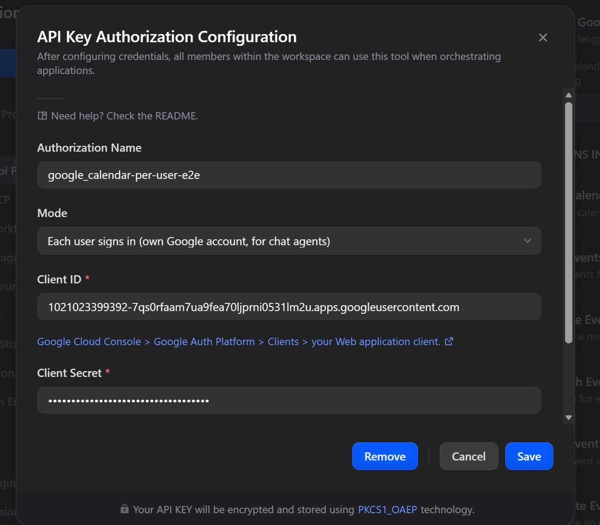
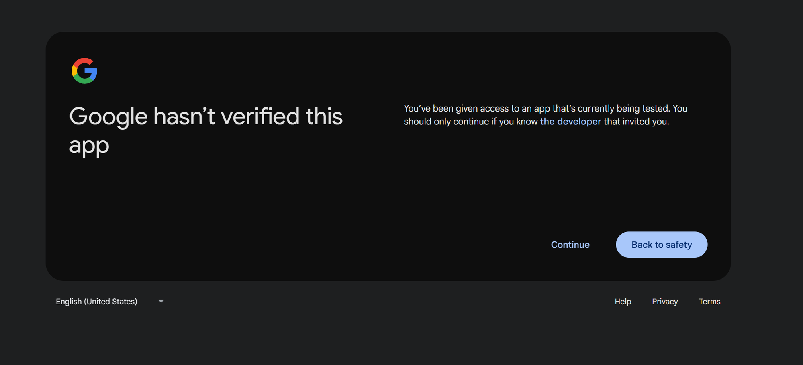

# Google Calendar Plugin

**Author**: langgenius
**Version**: 1.0.0
**Type**: tool

## Introduction

This plugin integrates with Google Calendar, supporting operations such as managing events, calendars, and scheduling. It enables automated calendar management in platforms like Dify.

## What's new in 1.0.0

- **Each user signs in**: in a chat agent, every user works on their own Google Calendar.
  - The first time someone needs it, the agent gives them a Google sign-in link.
  - After they sign in, the tools act as that person.
  - The OAuth credential (one shared account) keeps working as before.
- **New tools**:
  - `google_calendar_get_event`, `google_calendar_update_event`, `google_calendar_delete_event`.
  - `google_calendar_check_availability` (free/busy).
  - `google_calendar_sign_out`.
  - They return typed output variables for workflows.
- **Fixes in the original tools**:
  - Every call failed on recent Dify versions with "11 validation errors for DifyPluginToolInvokeMessage", because their log messages had no metadata.
  - Calendar IDs with `#` (such as holiday calendars) returned "not found", because the ID was not URL-encoded.

## Setup

1. Register your application in the [Google Cloud Console](https://console.developers.google.com/).

2. Create a new application as follows:
    - **Project Name**: Dify Google Calendar Plugin
    - **Enable APIs**: Go to "APIs & Services" > "Library", search for and enable "Google Calendar API"

    

        
    

    - **Create Credentials**: Select "OAuth 2.0 Client ID"

    

        
    

    - **Application Type**: Choose "Web application"
    - **Redirect URI**: Set the redirect URI to:
        - For SaaS (cloud.dify.ai) users: please use `https://cloud.dify.ai/console/api/oauth/plugin/langgenius/google_calendar/google_calendar/tool/callback`
        - For self-hosted users: please use `http://<YOUR_LOCALHOST_CONSOLE_API_URL>/console/api/oauth/plugin/langgenius/google_calendar/google_calendar/tool/callback`
        ***Due to the restrictions of the Google OAuth2 flow, redirect URIs must start with `https://` or `http://localhost`.***

3. Copy your **Application (client) ID**

    

        
    

4. Create a new client secret:
    - **Description**: Dify Google Calendar Plugin Secret
    - **Expires**: Whatever duration you prefer (e.g., 1 year, 2 years, etc.)
    - Copy the generated **Value** of the client secret.

5. Add a test user to the Google Calendar API:
    - Go to "APIs & Services" > "Credentials" > "OAuth consent screen" > "Test Users"
    - Add a test user with the email address you want to use for testing.

    

        
    

6. Configure the plugin in Dify:
    - Fill in the **Client ID** and **Client Secret** fields with the values you copied from the Google Cloud Console.
    - Make sure you have the same redirect URI as specified in the Google Cloud Console. If not, you will need to update it in the Google Cloud Console.
    - Click `Save and authorize` to initiate the OAuth flow.

7. Enjoy using the Google Calendar plugin in Dify!

## Each user signs in (for chat agents)

With the OAuth credential, everybody uses the one Google account that authorized the plugin. With **Each user signs in**, every chat user signs in with their own Google account.

1. **Create the sign-in endpoint**: open the plugin's details › **Endpoints** and create an endpoint (no settings). Copy its URL ending in `/google_calendar/callback`.
   - If the URL starts with `http://localhost`, set `ENDPOINT_URL_TEMPLATE` on the Dify API service to your public address, e.g. `https://dify.example.com/e/{hook_id}`.
   - Google only accepts `https://` redirect URIs, except for `localhost`.
2. **Register the URL with Google**: in Google Cloud Console › Google Auth Platform › **Clients**, open your Web application client and add that URL to **Authorized redirect URIs**. The same client can also keep the OAuth redirect URI from the setup above.
3. **Add a credential in Dify**: in the plugin's authorization, add an API-key style credential with:
   - **Mode**: *Each user signs in*.
   - **Client ID** and **Client Secret** of the same client.
   - **Sign-in Callback URL**: the endpoint URL.

   

4. **Use it in an agent**: add the Google Calendar tools to a chat agent with this credential.

**What users see**:
1. The agent replies with a Google sign-in link.
2. The user picks their account and allows access to their calendar. They must keep every box ticked; if a permission is unticked, the plugin asks them to sign in again.
3. The page shows *Signed in*. Back in the chat, the user says they are done.
4. The agent continues and says which account was signed in.

While the app's publishing status is **Testing**, Google shows "Google hasn't verified this app" first; click **Continue**. Only the app's **Test users** can sign in.

**Good to know**:
- **Signing out**: asking the agent to sign out of Google Calendar (`google_calendar_sign_out`) forgets that user's sign-in. Other Google plugins keep their own sign-ins.
- **Signing in again**: users are asked to sign in again when they revoke access (myaccount.google.com › Security › Third-party access) or when the Client Secret changes.
  - While the app is in **Testing**, Google expires refresh tokens after 7 days. Publish the app (Audience › Publish app) to avoid this.
  - Within a Google Workspace organization, an **Internal** app avoids both the 7-day expiry and the unverified-app notice.
- **Security**:
  - The endpoint only stores the one-time authorization code. The tool redeems it with the client secret and a PKCE verifier.
  - Per-user tokens are encrypted with a key derived from the Client Secret and never appear in tool output.
- **Tool name clashes**: the original tool names (`list_events`, `list_calendars`, `create_event`, `search_events`) are also used by Outlook. Dify's new Agent refuses duplicate tool names across plugins, so don't add both plugins to one agent.

## Tool Descriptions

### list_calendars
Retrieve all Google Calendar calendars accessible to the current user.

**Features:**
- No parameters required
- Returns a list of all accessible calendars
- Includes primary and secondary calendars
- Provides detailed calendar information (ID, name, description, access permissions, etc.)

### list_events
Retrieve events from a specific calendar within a date range.

**Parameters:**
- calendar_id (string, optional): The ID of the calendar to list events from (use 'primary' for main calendar, default: 'primary')
- time_min (string, optional): Lower bound for event start time (ISO format, e.g., 2024-01-01T00:00:00Z)
- time_max (string, optional): Upper bound for event start time (ISO format, e.g., 2024-12-31T23:59:59Z)
- max_results (number, optional): Maximum number of events to return (1-2500, default: 10)
- show_deleted (boolean, optional): Whether to include deleted events (default: false)
- single_events (boolean, optional): Whether to expand recurring events into individual instances (default: true)
- order_by (select, optional): Order events by (startTime: start time, updated: last updated, default: startTime)

### create_event
Create a new event in the specified calendar.

**Parameters:**
- title (string, required): The title/summary of the event
- start_time (string, required): Event start time (ISO format, e.g., 2024-01-01T10:00:00Z)
- end_time (string, optional): Event end time (ISO format). If not provided, defaults to 1 hour after start time
- calendar_id (string, optional): The calendar ID to create the event in (use 'primary' for main calendar, default: 'primary')
- all_day (boolean, optional): Whether this is an all-day event (default: false)
- description (string, optional): Detailed description of the event
- location (string, optional): Event location (address, meeting room, etc.)
- attendees (array, optional): List of attendee email addresses
- time_zone (string, optional): Time zone for the event (e.g., America/New_York, Asia/Tokyo)
- visibility (select, optional): Event visibility setting (default: default, public: public, private: private, default: default)
- send_notifications (boolean, optional): Whether to send email notifications to attendees (default: true)

### search_events
Search for events in Google Calendar using text queries.

**Parameters:**
- query (string, required): Text to search for in event titles, descriptions, locations, or attendees
- calendar_id (string, optional): The calendar ID to search in (use 'primary' for main calendar, default: 'primary')
- time_min (string, optional): Lower bound for event start time (ISO format, e.g., 2024-01-01T00:00:00Z)
- time_max (string, optional): Upper bound for event start time (ISO format, e.g., 2024-12-31T23:59:59Z)
- max_results (number, optional): Maximum number of search results to return (1-250, default: 25)
- order_by (select, optional): Order search results by (startTime: start time, updated: last updated, default: startTime)
- show_deleted (boolean, optional): Whether to include deleted events in search results (default: false)
- single_events (boolean, optional): Whether to expand recurring events into individual instances (default: true)

### google_calendar_get_event
One event with its time, location, description, guests and their responses, and the meeting link.

### google_calendar_update_event
Change an event; only the given fields change.
- **Fields**: `title`, `start_time`, `end_time`, `all_day`, `time_zone`, `location`, `description`, `attendees`, `visibility`.
- **Guests**: they are added to the event, or replace the existing guests with `attendees_mode: replace`.
- **Who is notified**: `send_updates` is `all`, `externalOnly` or `none`.
- **Time zones**: a time without a UTC offset uses `time_zone`, or the event's own time zone.
- **All-day events**: end dates are exclusive. Moving a one-day event sets its end to the next day.

### google_calendar_delete_event
Delete an event (`send_updates` chooses who is notified).

### google_calendar_check_availability
Busy periods of one or more calendars between `time_min` and `time_max`.
- **Calendars**: calendar IDs, or people's emails when they share their free/busy information.
- **Output**: `free` (true when nothing is busy) and `busy`.

### google_calendar_sign_out
Each user signs in only: forget the current user's sign-in.

## Troubleshooting

| Message | Fix |
|---|---|
| `Error 403: access_denied` (*has not completed the Google verification process*) | The app is in Testing and this account is not a test user. Add it under Google Auth Platform › Audience › **Test users**, then save. |
| `Error 400: redirect_uri_mismatch` | Add the exact endpoint URL (or Dify's OAuth redirect URL) to the client's Authorized redirect URIs. |
| *The sign-in did not grant every permission* | The user unticked the calendar permission. Ask them to sign in again and keep every box ticked. |
| `Duplicate Dify Tool name 'list_calendars'` | Outlook is in the same agent. Use separate agents. |

## Privacy

When using this plugin, your Google Calendar data will be accessed through a secure OAuth connection. The plugin only accesses and operates on your calendar data within the scope you authorize. Please refer to Google's privacy policy for more information about data handling.

## Usage Examples

1. **Get Calendar List**: Use the `list_calendars` tool to view all available calendars
2. **View Today's Events**: Use the `list_events` tool with today's date range
3. **Create a Meeting**: Use the `create_event` tool to create a new meeting event with title, time, location, and attendees
4. **Search Specific Events**: Use the `search_events` tool to find relevant events by keywords

Last updated: November 2, 2026
