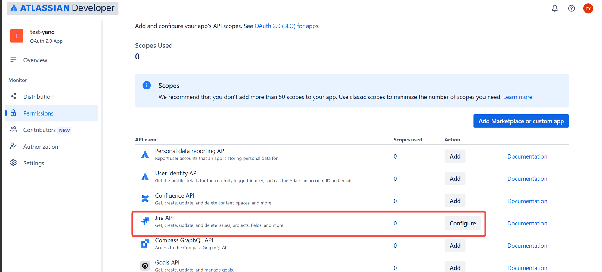
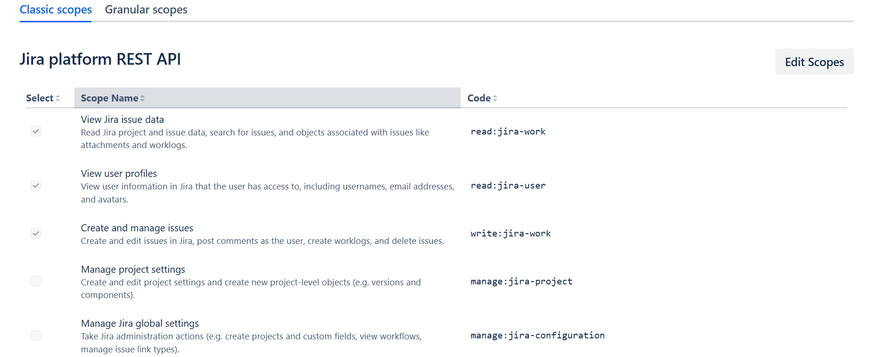
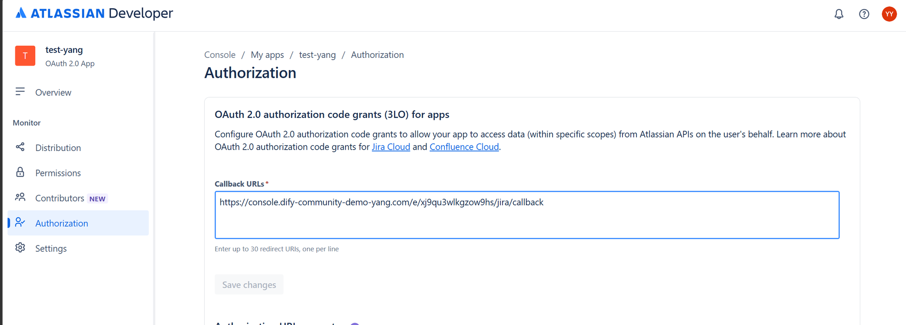
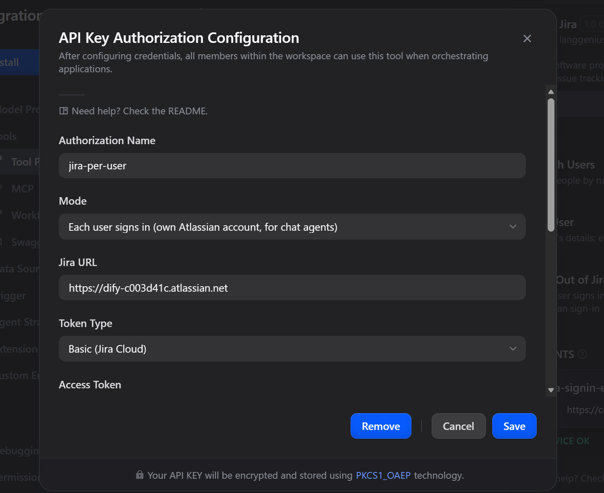
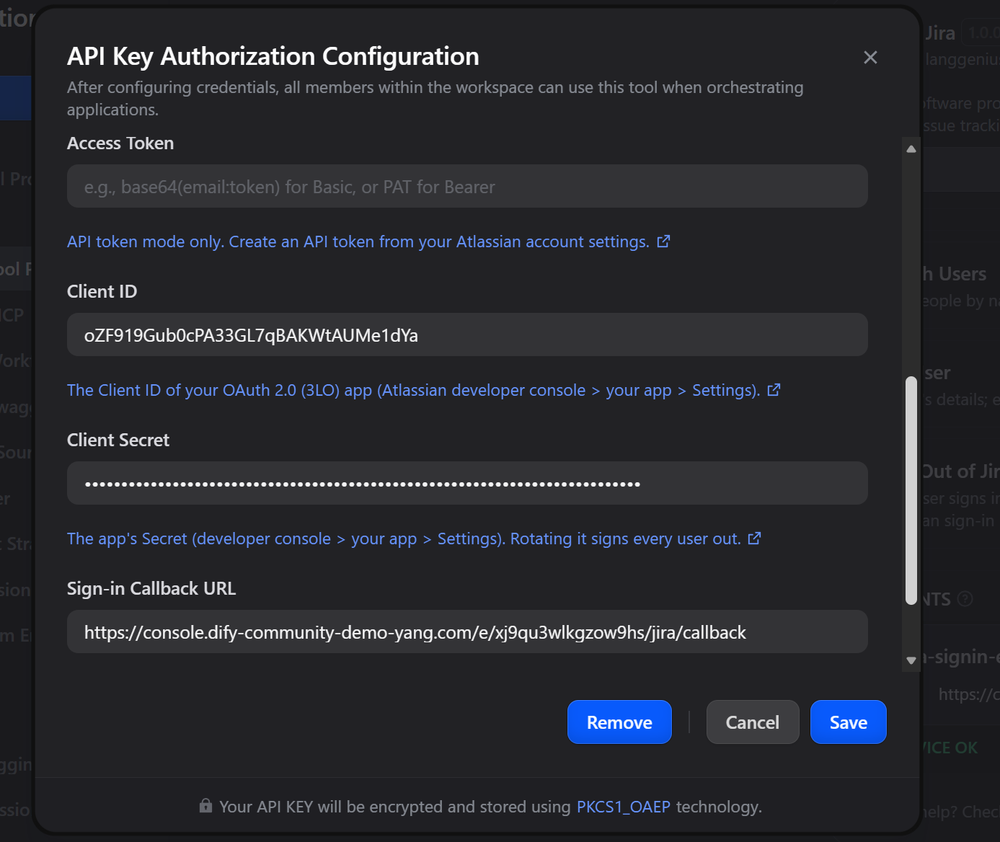
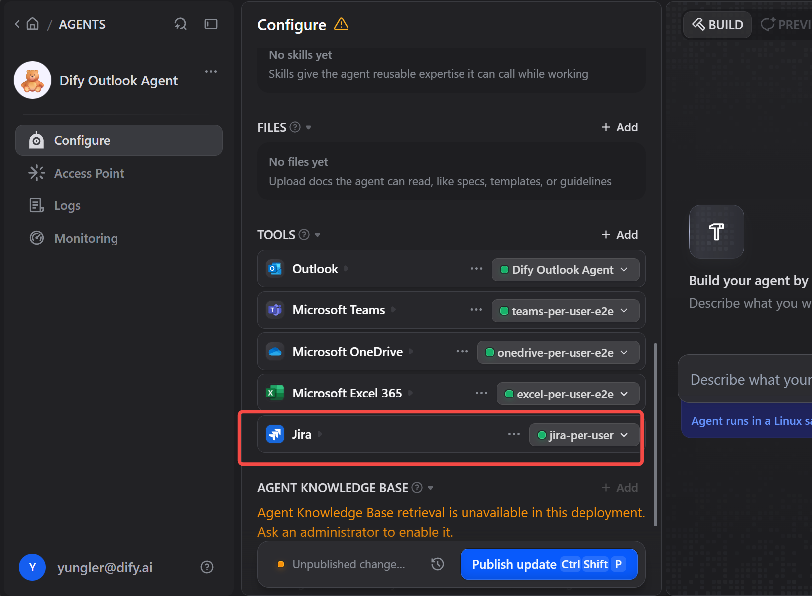
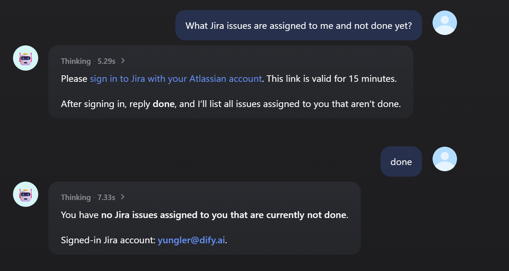

## Dify Plugin for Jira

Search, create, update and move Jira issues, work with comments, attachments and people, and list projects and boards. Works with Jira Cloud and Jira Server / Data Center.

### What's new in 1.0.0

- **OAuth**: authorize the plugin with an Atlassian account from the Dify console, without an API token.
- **Each user signs in**: in a chat agent, every user works in Jira as themselves. The first time someone needs Jira, the agent gives them an Atlassian sign-in link. After they sign in, the tools act with that person's own Jira permissions.
- 17 new tools that bring the plugin in line with n8n's Jira node: JQL search, update, status transitions, changelog, notifications, comments, attachments and users.
- Typed output variables (and `success` / `error`) on the new tools, for workflows.
- `create_issue` takes a project key as well as an ID, plus optional assignee, priority, labels, due date, parent and custom fields.

Existing API-token credentials keep working unchanged.

### Tools

| Area | Tools |
|---|---|
| Issues | `jira_search_issues` (JQL), `get_issue`, `create_issue`, `jira_update_issue`, `delete_issue`, `jira_get_changelog`, `jira_notify_issue` |
| Status | `jira_list_transitions`, `jira_transition_issue` (by target status, transition name or ID, with an optional comment) |
| Comments | `jira_add_comment`, `jira_list_comments`, `jira_get_comment`, `jira_update_comment`, `jira_delete_comment` |
| Attachments | `jira_add_attachment` (a file, or text plus a file name), `jira_list_attachments`, `jira_get_attachment` (returns the file, up to 50 MB), `jira_delete_attachment` |
| People | `jira_search_users` (find an account ID by name or email), `jira_get_user` (empty = the signed-in account) |
| Projects & boards | `list_projects`, `get_project`, `get_recent_projects`, `list_issues_type`, `list_boards`, `get_board`, `list_issues_for_board` |
| Sign-in | `jira_sign_out` (Each user signs in only) |

Descriptions and comments accept Markdown. On Jira Cloud it is converted to Atlassian Document Format; on Server it is sent as text.

n8n's "create user" and "delete user" are not included. They need site-admin rights and are rarely something an agent should do.

### Choose how to connect

| Mode | Who Jira sees | Jira | What you need |
|---|---|---|---|
| **API token** | The token's account, for everyone | Cloud, Server / Data Center | Jira URL + API token or personal access token |
| **OAuth** | The account that authorized, for everyone | Cloud | An Atlassian OAuth 2.0 (3LO) app |
| **Each user signs in** | Each chat user, as themselves | Cloud | The same OAuth app + this plugin's sign-in endpoint |

#### API token

1. Create an API token at [id.atlassian.com › Security › API tokens](https://id.atlassian.com/manage-profile/security/api-tokens). For Server / Data Center, create a personal access token in your Jira profile instead.

   

2. In Dify, open the plugin's authorization and choose **Mode: API token / personal access token**. Then fill in:
   - **Jira URL**: e.g. `https://your-domain.atlassian.net`.
   - **Token Type**:
     - `Basic` for Cloud. The Access Token is `base64(email:api_token)`.
     - `Bearer` for Server / Data Center. The Access Token is the personal access token.
   - **Access Token**.

#### Create the Atlassian OAuth app (for OAuth and Each user signs in)

1. Go to the [Atlassian developer console](https://developer.atlassian.com/console/myapps/) and choose **Create › OAuth 2.0 integration**.
2. **Permissions**:
   - Add **Jira API**, then click **Configure** on it.
   - **Classic scopes** tab › **Edit Scopes**: `read:jira-work`, `write:jira-work`, `read:jira-user`.
   - **Granular scopes** tab › **Edit Scopes**, for the board tools: `read:board-scope:jira-software`, `read:project:jira`, `read:issue-details:jira`.
   - `offline_access` (to stay signed in) is not listed in the console. It is always allowed and the plugin requests it automatically. No User identity API scope is needed.

   

   

3. **Authorization › OAuth 2.0 (3LO)**: set the **Callback URLs** (up to 30, one per line), then **Save changes**:
   - **OAuth**: the redirect URL that Dify shows in the plugin's OAuth client settings.
   - **Each user signs in**: the sign-in endpoint URL from the next section.

   

4. **Settings**: copy the **Client ID** and **Secret**. Leave **Access type** at its default.

   

5. **Distribution**: an app in development can only be used by its owner. To let other people sign in, set **Distribution** to *Sharing* and fill in the form; Atlassian approves it immediately.

If you request a scope that the app does not have, Atlassian rejects the sign-in. Scopes can be changed in the plugin's **Scopes** field. Every scope listed there must also be added to the app.

#### OAuth

In the plugin's authorization, choose OAuth and open the client settings. Enter the **Client ID** and **Client Secret**. **Jira Site URL** is optional; it is only needed if the account can reach several Atlassian sites. Then click **Authorize** and approve access on Atlassian's consent screen.

#### Each user signs in

1. Open the plugin's details › **Endpoints** and create an endpoint (no settings).
   - Copy its URL that ends in `/jira/callback`, e.g. `https://dify.example.com/e/abc123/jira/callback`.
   - If the URL starts with `http://localhost`, set `ENDPOINT_URL_TEMPLATE` on the Dify API service to your public Dify address (e.g. `https://dify.example.com/e/{hook_id}`). Otherwise users' browsers cannot reach it.
2. Paste that URL as the OAuth app's **Callback URL** in the developer console.
3. In the plugin's authorization, add an API-key style credential with:
   - **Mode**: *Each user signs in*. It is the first field of the form. If you leave it on *API token* but fill in the app fields and no token, the plugin uses Each user signs in anyway.
   - **Client ID**, **Client Secret**.
   - **Sign-in Callback URL**: the endpoint URL.
   - **Jira URL**: optional. It picks the site when users can reach several sites. Otherwise the first Jira site they grant is used.

   

   

4. Add the Jira tools to a chat agent with this credential.

   

**What users see**:
1. A user asks for something in Jira, and the agent replies with an Atlassian sign-in link.
2. The user opens the link, signs in, and on Atlassian's consent screen picks the Jira site and clicks **Accept**.
3. The page shows *Signed in*. The user goes back to the chat and says they are done.
4. The agent continues and says which account was signed in.
5. Later requests use the stored sign-in, with no link.

**Good to know**:
- **Different users**: each Dify user gets their own sign-in. In a published WebApp without login, each browser counts as a separate user.
- **Signing out**: asking the agent to sign out of Jira (`jira_sign_out`) forgets that user's sign-in.
- **Signing in again**: users are asked to sign in again after about 90 days without using Jira, when they revoke the app in their Atlassian account, or when the Client Secret is changed.
- **Forwarded links**: the sign-in link connects the account to the chat that asked for it. The callback page warns people who did not start the sign-in themselves and lets them cancel it.

### Security notes

- **Where tokens are stored**: per-user tokens live in the plugin's own storage. They are encrypted with a key derived from the Client Secret and never appear in tool output or logs.
- **What the endpoint does**: it only stores the one-time authorization code. Only the tool can redeem the code, because only the tool has the Client Secret.
- **Where OAuth tokens are sent**: only to `api.atlassian.com`. Attachments are downloaded through the API, and links found in Jira responses are never followed with a token.
- **Path safety**: issue keys and IDs are URL-encoded, so a value chosen by the model cannot change which API is called.

### Troubleshooting

| Message | Fix |
|---|---|
| `invalid_scope` or *Something went wrong* on Atlassian's page | A requested scope is missing from the app. Add it in the developer console, or remove it from **Scopes**. |
| *The redirect_uri is not registered* | The app's Callback URL must exactly match the endpoint URL (or Dify's OAuth redirect URL). |
| *The account has no access to https://…* | The **Jira URL / Site URL** does not match a site the user granted. Fix the URL or leave it empty. |
| Other people cannot sign in | The app is still private. Set **Distribution** to *Sharing*. |
| `Jira API error 403` | The account lacks the Jira permission, or the app lacks the scope, for that action. |
