# Outlook

Dify's integration with Microsoft Outlook (via Microsoft Graph) for **email and calendar**: read, send and organize mail, and manage calendar events.

**Version:** 1.0.0

## Choose how to authorize

| Mode | Whose mailbox the tools use | Use it for |
|---|---|---|
| **OAuth** | The one person who signed in from the Dify console. Everyone who uses the tool shares that mailbox. | A workflow or app that works on one known mailbox |
| **Service Principal** (0.7.0) | A mailbox you name, accessed as the app itself; no user signs in | Automation on shared or service mailboxes |
| **Each user signs in** (1.0.0) | The mailbox of whoever is chatting with the agent. Each user signs in once with their own Microsoft account. | A chat agent that many people use ("what's on my calendar today?") |

All three use the same Microsoft Entra app registration (step 1 below) and can exist side by side: add several authorizations to the plugin and pick one per agent or workflow node.

## Features

### Email
- **List Messages**: list messages from your Outlook inbox.
- **Get Message**: details of an email by its ID, including attachment IDs.
- **Download Attachment**: download an email attachment as a file (from a `message_id` and an `attachment_id`); Dify serves it over a public HTTPS URL.
- **Send Message**: send an email through Outlook, with optional file attachments.
- **Send Draft**: send a draft (needs a draft ID from Draft Email).
- **Draft Email**: create a draft.
- **List Draft Emails**: list your drafts.
- **Add Attachment to Draft**: add a file attachment to a draft.
- **Prioritize Email**: set the importance of an email.
- **Flag Message**: flag or unflag a message.

### Calendar
- **List Calendars**: list your calendars.
- **List Events**: list upcoming events, optionally from one calendar.
- **Search Events**: find events by keyword and/or date range.
- **List Calendar Groups** (0.7.0): calendar groups such as *My Calendars* and *People's calendars*; calendars other people shared with you are usually in the latter.
- **Calendar groups and shared calendars** (0.7.0): List Calendars, List Events and Search Events take an optional **Calendar Group ID**; they cover every calendar in the group and tag each event with its calendar and owner. Needs `Calendars.Read.Shared`.
- **Get Schedule** (0.7.0): free/busy of people for a time window, by email and/or a calendar group. Works for anyone in the organization without calendar sharing; subjects only where you may see them.
- **Create Event**: create a meeting or appointment (attendees, location, Teams online meeting).
- **Get Event**, **Update Event**, **Delete Event**.

### Account
- **Sign Out** (1.0.0): *Each user signs in* only. Forgets the current user's Microsoft sign-in, for switching accounts.

## Step 1: Register an app in Microsoft Entra ID

Every mode needs an app registration. You need an account that may register apps and grant admin consent in your tenant.

1. Open the [Microsoft Entra admin center](https://entra.microsoft.com) → **App registrations** → **New registration**.

   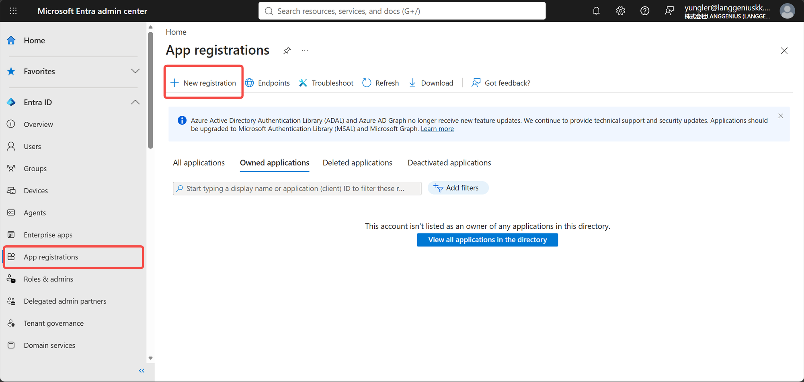

2. Enter a name (for example `Dify Outlook`) and keep **Single tenant only**. Under **Redirect URI**, choose **Web**. If you will use OAuth, enter the callback URL that Dify shows (see [OAuth](#oauth)); otherwise leave it empty and add redirect URIs later. Click **Register**.

   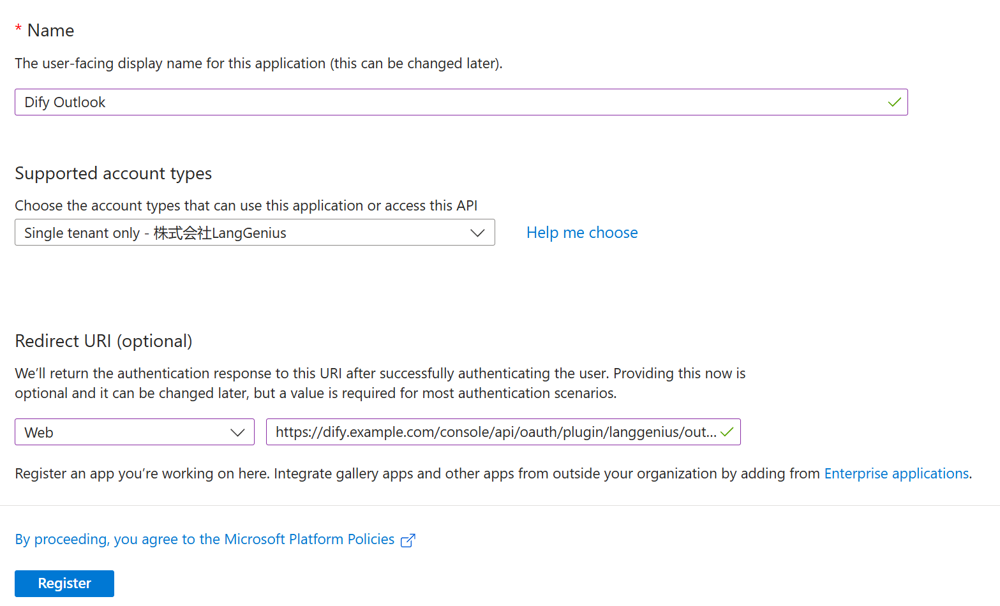

3. On the app's **Overview**, copy the **Application (client) ID** and the **Directory (tenant) ID**.

   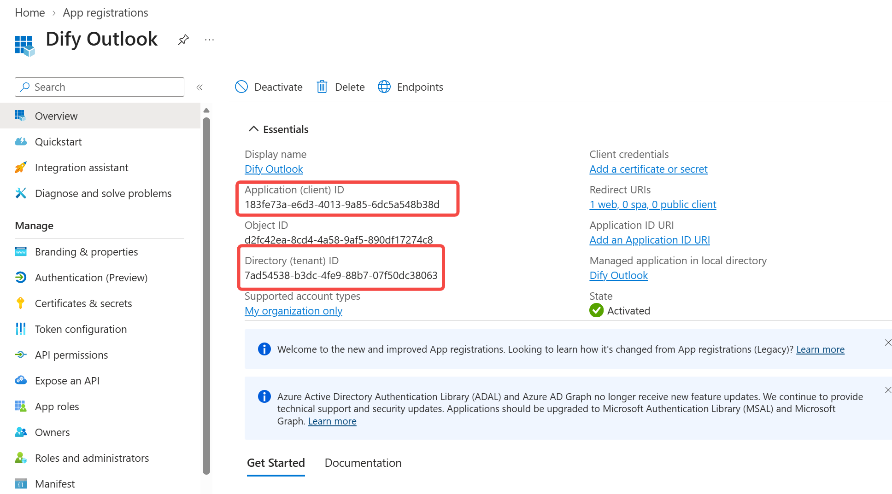

4. Under **API permissions** → **Add a permission** → **Microsoft Graph**, add the permissions for the modes you will use:

   | Permission | Type | Needed by |
   |---|---|---|
   | `Mail.Read`, `Mail.ReadWrite`, `Mail.Send` | Delegated | OAuth, Each user signs in |
   | `Calendars.ReadWrite` | Delegated | OAuth, Each user signs in |
   | `Calendars.Read.Shared` | Delegated | OAuth, Each user signs in (shared calendars, Get Schedule) |
   | `offline_access` | Delegated | OAuth, Each user signs in (keeps users signed in) |
   | `Mail.ReadWrite`, `Mail.Send`, `Calendars.ReadWrite` | Application | Service Principal |

   The `User.Read` permission that new apps get by default can stay.

5. Click **Grant admin consent for \<your organization\>** and confirm with **Yes**. Service Principal requires this. For *Each user signs in* it is strongly recommended: users then never see a consent screen, and signing in takes one click if they are already signed in to Microsoft in the browser.

   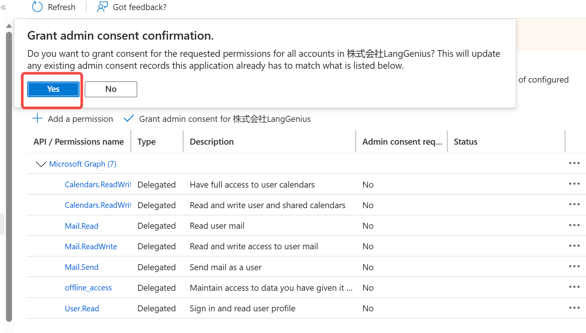

6. Under **Certificates & secrets** → **Client secrets**, click **New client secret**. Copy the **Value** right away (it is shown only once); the **Secret ID** is not the secret.

   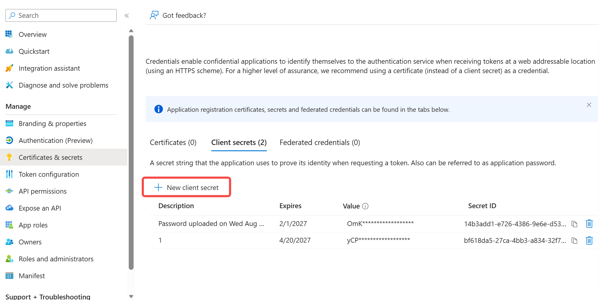

Then set up the mode you chose.

## OAuth

1. In Dify, open **Plugins** → **Outlook**. Next to **Add OAuth**, click the settings icon.

   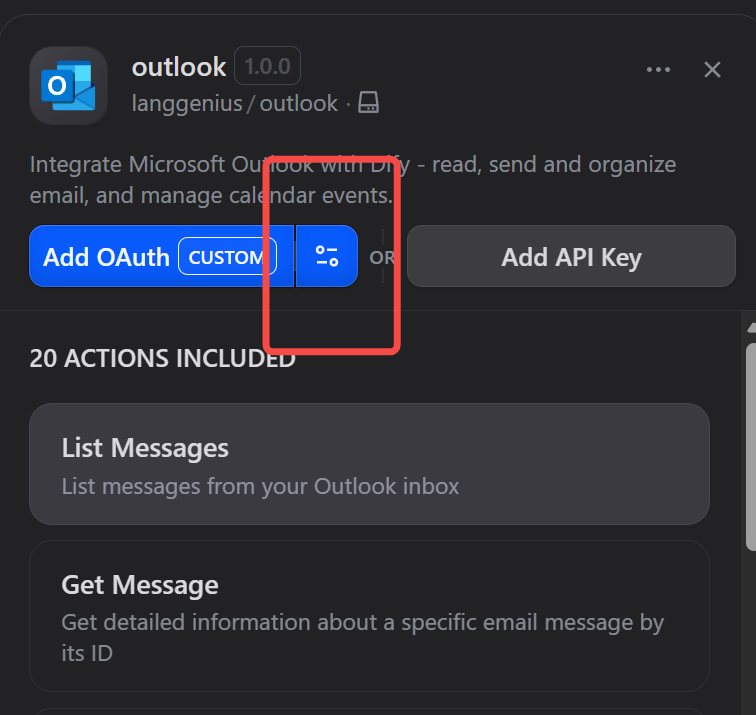

2. The dialog shows the redirect URI to use: add it to the app registration (**Authentication** → **Add Redirect URI** → **Web**). Fill in **Client ID**, **Client Secret** and **Tenant ID** (leave it blank or `common` for personal or multi-tenant accounts), choose the Microsoft Cloud, and save.

   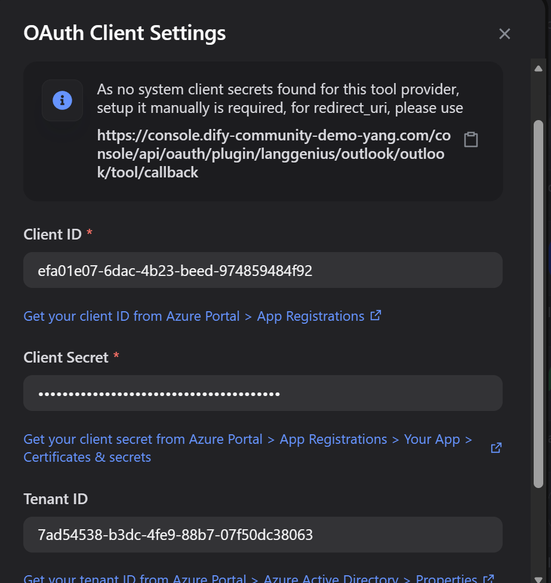

3. Click **Add OAuth** and sign in with the Microsoft account whose mailbox the tools should use.

> Upgrading from before 0.7.0 adds the `Calendars.Read.Shared` scope: add it to the app registration and authorize again once.

## Service Principal

Use this when a workflow should run as the organization rather than as a person: nobody signs in, nothing breaks when someone leaves, and the audit log shows the app.

1. Give the app the **Application** permissions from step 1 and grant admin consent.
2. Recommended: limit the app to the mailboxes it needs with an Exchange Online [RBAC for Applications](https://learn.microsoft.com/exchange/permissions-exo/application-rbac) assignment. Otherwise application permissions reach every mailbox in the tenant.
3. In Dify, click **Add API Key**, set **Mode** to *Service Principal*, and fill in **Tenant ID** (your directory ID, not `common`), **Client ID**, **Client Secret** and **Default Mailbox** (for example `support@contoso.com`). Dify signs in and reads that inbox to check the permissions.
4. Each tool has an optional **Mailbox** setting, set in the node and never chosen by the LLM, to use a different mailbox with the same authorization.

## Each user signs in: a personal Outlook assistant

Build an agent that answers "What's in my email?" and "What's on my calendar today?" for whoever is chatting with it. The first time a user needs Outlook, the agent gives them a Microsoft sign-in link. After they sign in, the tools act on their own mailbox and calendar, and they stay signed in for later conversations.

### 1. Create the sign-in endpoint

The plugin receives the browser's return from Microsoft at its own endpoint.

1. In **Plugins** → **Outlook**, scroll to **ENDPOINTS** and click **+**.

   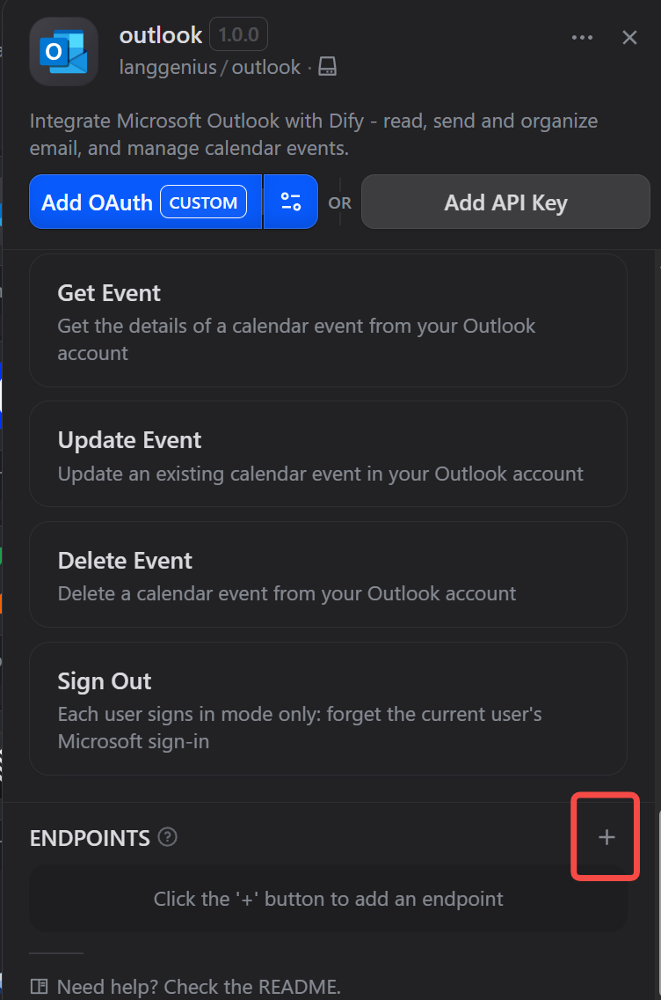

2. Enter a name and save. There is nothing else to fill in.

   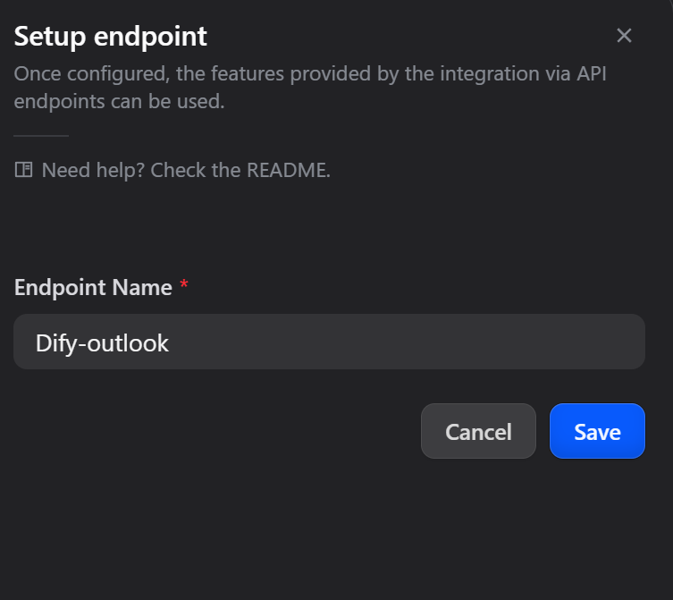

3. Copy the endpoint URL with the copy button. It looks like `https://<your-dify-domain>/e/<id>/outlook/callback`.

   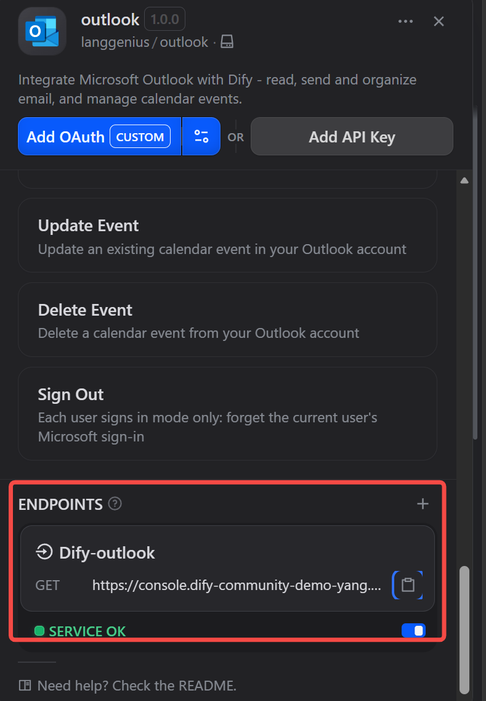

> **The URL starts with `http://localhost`?** Your self-hosted Dify still uses the default `ENDPOINT_URL_TEMPLATE=http://localhost/e/{hook_id}`. The endpoint is served at your real domain; only the displayed URL is wrong. Either set `ENDPOINT_URL_TEMPLATE=https://<your-dify-domain>/e/{hook_id}` in `docker/.env` and restart the API (`docker compose up -d api`), or replace `http://localhost` in the copied URL with your Dify address. Microsoft accepts `http` only for `localhost`, so the URL must use `https`.
>
> 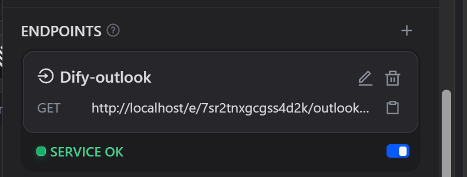

### 2. Register the endpoint URL with Microsoft

In the app registration, open **Authentication** → **Add Redirect URI** → **Web**, paste the endpoint URL and click **Configure**. Make sure it is the `https` URL, not `localhost`; a mismatch shows up later as error `AADSTS50011` on the Microsoft sign-in page.

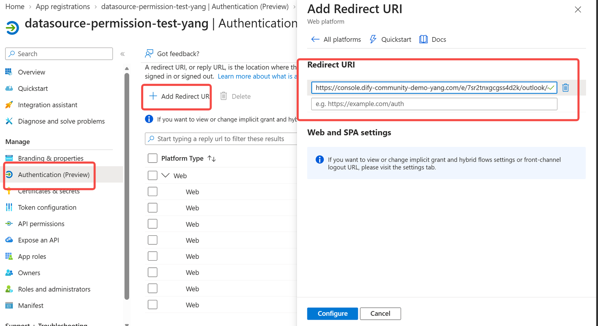

### 3. Add the authorization in Dify

1. In **Plugins** → **Outlook**, click **Add API Key**.

   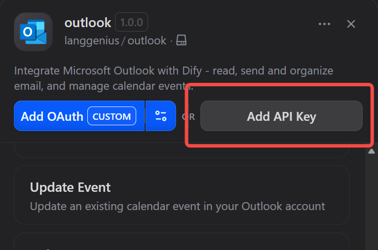

2. Fill in the form:
   - **Authorization Name**: any name, for example `Dify Outlook Agent`.
   - **Mode**: *Each user signs in (own mailbox, for chat agents)*.
   - **Tenant ID**: your directory (tenant) ID. It limits sign-in to accounts of your organization.
   - **Client ID** and **Client Secret**: from step 1.

   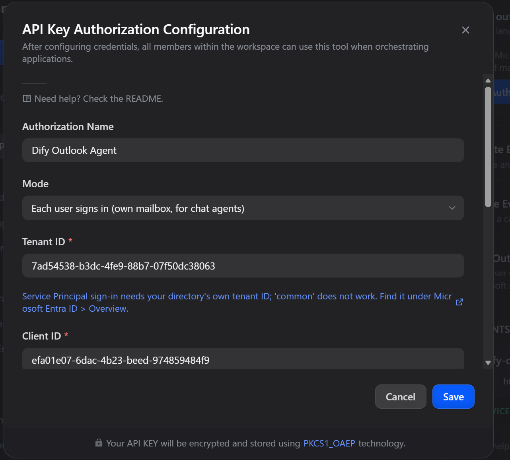

   - **Default Mailbox**: leave empty; it is not used in this mode.
   - **Sign-in Callback URL**: the endpoint URL from section 1. Dify rejects a `localhost` URL.
   - **Microsoft Cloud**: *Global* unless your tenant is in a national cloud.

   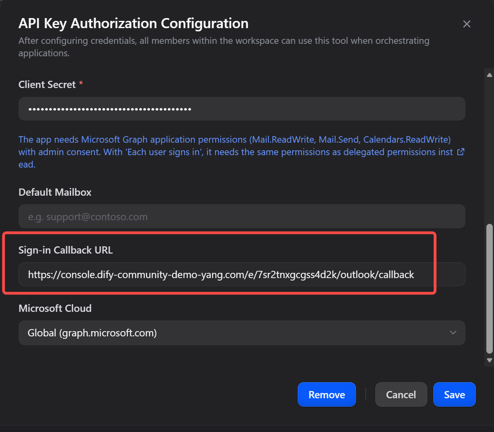

   On save, Dify checks the fields and, with a specific tenant ID, that Microsoft accepts the client ID and secret. No user's mailbox is accessed, and the authorization stores no user token.

### 4. Set up the agent

1. Create an agent, click **Add** under **TOOLS**, and add **Outlook**. Keep the email and calendar tools you want and **Sign Out**.
2. In the credential menu next to Outlook, choose the authorization from section 3. If the menu shows an OAuth authorization instead, the tools act on that one shared mailbox and Sign Out does nothing.

   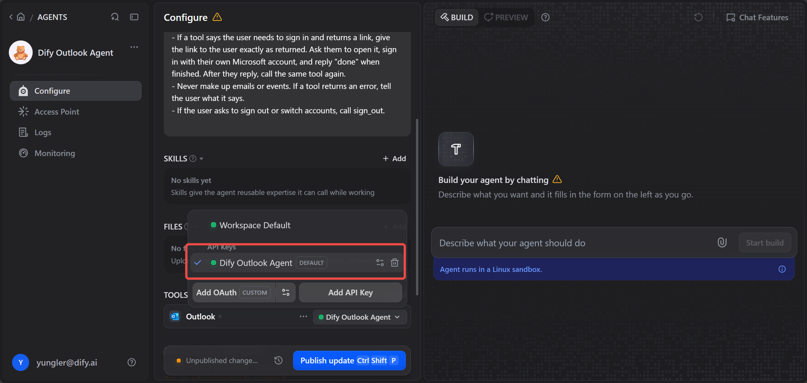

3. Use instructions like these:

   ```
   You can use the Outlook tools to access the current user's own mailbox and calendar.
   - When the user asks about their schedule or meetings, call list_events or search_events.
   - When the user asks about their email, call list_messages or get_message. Create a draft instead of sending unless the user clearly asks you to send.
   - If a tool says the user needs to sign in and returns a link, give the link to the user exactly as returned. Ask them to open it, sign in with their own Microsoft account, and reply "done" when finished. After they reply, call the same tool again.
   - Never make up emails or events. If a tool returns an error, tell the user what it says.
   - If the user asks to sign out or switch accounts, call sign_out.
   ```

4. Publish the agent.

### 5. What users see

1. The first question returns a sign-in link, valid for 15 minutes.

   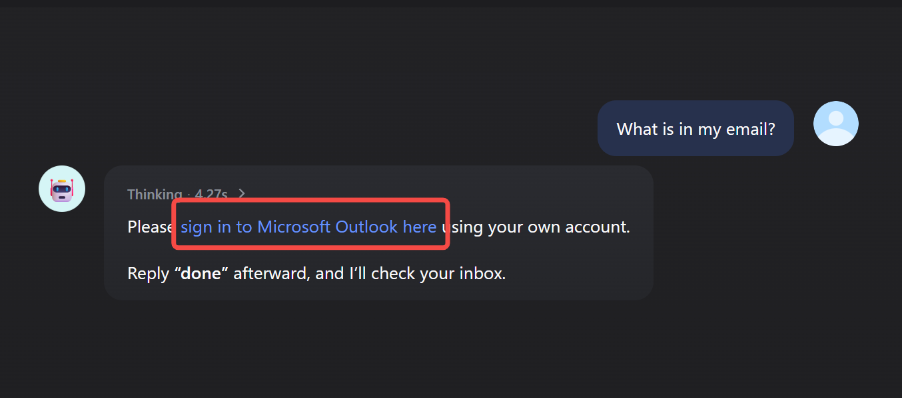

2. The user opens it and signs in with their own Microsoft account.

   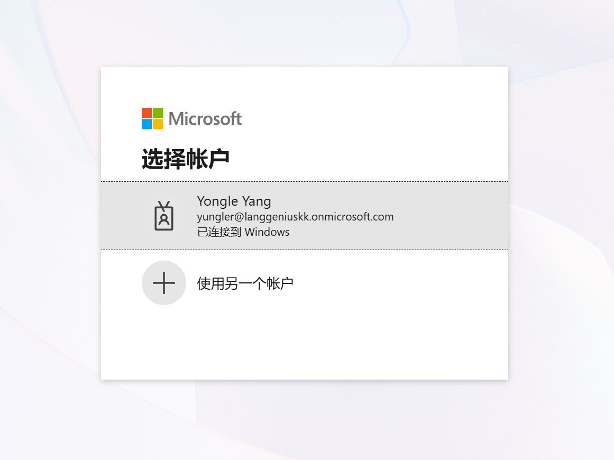

3. A page titled **Signed in** asks them to go back to the chat and say they are done. It also says to continue only if they started the sign-in themselves; if someone else sent them the link, they can cancel it there.
4. They reply "done", and the agent answers from their own mailbox. The first answer after signing in mentions the account used, so a wrong account is easy to spot.

   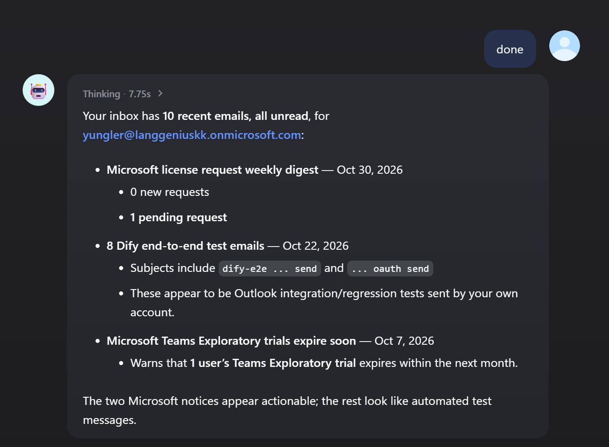

5. "Sign out" forgets their sign-in; the next request asks them to sign in again.

   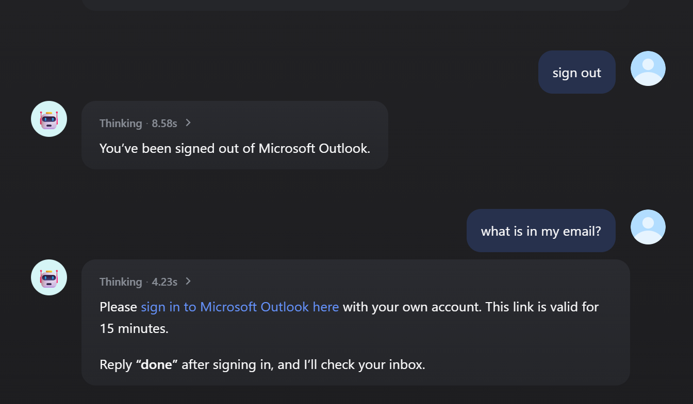

### How long users stay signed in

The access token is renewed in the background every hour, and Microsoft's refresh token stays valid while it is used (about 90 days of inactivity), so active users normally sign in once. Plugin upgrades keep sign-ins. Users are asked to sign in again when:

- **Dify sees a different user.** The plugin identifies users by Dify's user ID:
  - In the console (debugging and preview), it is the member's account: stable.
  - In a **public web app without login**, every browser (and private window, or cleared cookies) is a new anonymous user who signs in separately.
  - Through the **Service API**, it is the `user` value the caller sends. Keep it the same for the same person. The caller can put any value there, so only call the API from a trusted backend that has authenticated the user.
  - Passing `sys.user_id` in a web app URL makes the ID stable, but anyone can edit the URL and act as another user. Use it only for demos.
- They sign out, change their password, or an administrator revokes their sessions or the app's consent.
- Your organization's Conditional Access requires signing in again after a set time.
- The **client secret is rotated**: tokens are encrypted with a key derived from it, so everyone signs in again.

### Security notes

- Tokens never reach the agent: tool results carry data, not tokens, so prompt injection cannot leak them. Each user's tokens are kept encrypted in the plugin's storage and are not written to logs.
- One user can never use another user's sign-in; the user ID comes from Dify, not from the LLM.
- The endpoint only holds a one-time authorization code briefly. Turning it into a token also needs the client secret and a PKCE verifier that the endpoint never sees.
- A user could send their own sign-in link to a colleague. If the colleague signs in with it, the colleague's mailbox is connected to the sender's chat. The **Signed in** page warns about this and offers **cancel this sign-in**. Tell users to sign in only from links they asked for. An administrator can end any connection by revoking the user's sessions in Entra.
- To disconnect everyone at once, rotate the client secret or remove the app's consent in Entra.

## National clouds

OAuth, Service Principal and Each user signs in have a **Microsoft Cloud** setting: Global, US Government, US Government DoD, or China (21Vianet). It switches the sign-in host and the Microsoft Graph host together. Existing authorizations keep using the global cloud.

## Usage

Add the Outlook tools to an agent or a workflow, fill in the inputs, and run. For calendar, a common flow is **List Calendars** → **Create Event** / **List Events**.

To look at the calendars of people who shared theirs with you (for example an assistant and the executives): **List Calendar Groups** → take the ID of *People's calendars* → **Search Events** with that Calendar Group ID and a date range, or **Get Schedule** with it for free/busy.

## Output variables

Besides `text` and `json` (unchanged), every tool returns typed variables that later workflow nodes can pick directly, without parsing `json`. Every tool has `success` (boolean) and `error` (string, empty on success), so a workflow can branch with an IF node; list tools return an array of flat items plus `count`.

| Tool | Variables (besides `success`, `error`) |
|---|---|
| List Messages | `messages`, `count` |
| Get Message | `message_id`, `conversation_id`, `subject`, `from_name`, `from_address`, `to`, `cc`, `received_datetime`, `body`, `body_type`, `web_link`, `attachment_ids`, `attachment_names` |
| Download Attachment | `file_name`, `content_type`, `size`, `downloaded` |
| Send Message | `subject`, `to`, `attachment_count` |
| Send Draft | `draft_id`, `subject` |
| Draft Email | `draft_id`, `subject`, `conversation_id`, `web_link` |
| List Draft Emails | `drafts`, `count` |
| Add Attachment to Draft | `attachments`, `count` |
| Prioritize Email | `message_id`, `importance` |
| Flag Email | `message_id`, `flag_status` |
| List Calendar Groups | `calendar_groups`, `count` |
| List Calendars | `calendars`, `count` |
| List Events | `events`, `count`, `errors` |
| Search Events | `events`, `count`, `errors` |
| Get Schedule (Free/Busy) | `schedules`, `busy_people`, `count` |
| Create Event | `event_id`, `subject`, `start`, `end`, `time_zone`, `location`, `web_link`, `online_meeting_url` |
| Get Event | `event_id`, `subject`, `start`, `end`, `time_zone`, `location`, `web_link`, `online_meeting_url` |
| Update Event | `event_id`, `subject`, `start`, `end`, `time_zone`, `location`, `web_link`, `online_meeting_url` |
| Delete Event | `event_id` |
| Sign Out | `signed_out` |

## Troubleshooting

| Symptom | Cause and fix |
|---|---|
| `AADSTS50011: The redirect URI ... does not match` on the Microsoft page | The URL in the request is not registered on the app. Add exactly that URL under **Authentication** → **Web**. For Each user signs in, it must be the `https` endpoint URL, not `localhost`. |
| `AADSTS7000215` / invalid client secret | Use the secret's **Value**, not its Secret ID, and check it has not expired. |
| `OAuth credential for tool provider ... could not be refreshed` | The agent or node uses an OAuth authorization whose sign-in expired or was revoked. Authorize again, or choose another authorization. |
| Sign Out says the credential is shared by the workspace | The agent uses an OAuth or Service Principal authorization. Choose the *Each user signs in* authorization. |
| Users are asked to sign in again in another browser | The web app is public, so each browser is a different anonymous Dify user. See [How long users stay signed in](#how-long-users-stay-signed-in). |
| The endpoint URL starts with `http://localhost` | Set `ENDPOINT_URL_TEMPLATE`, see [section 1](#1-create-the-sign-in-endpoint). |
| A Service Principal tool returns 403 for a mailbox | Admin consent is missing for the application permissions, or an Exchange RBAC for Applications scope excludes that mailbox. |

## Privacy

This plugin sends the inputs of the selected operation to Microsoft Graph. With *Each user signs in*, it keeps each user's tokens, encrypted, in the plugin's storage. See [PRIVACY.md](PRIVACY.md) for details.
