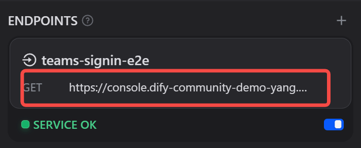
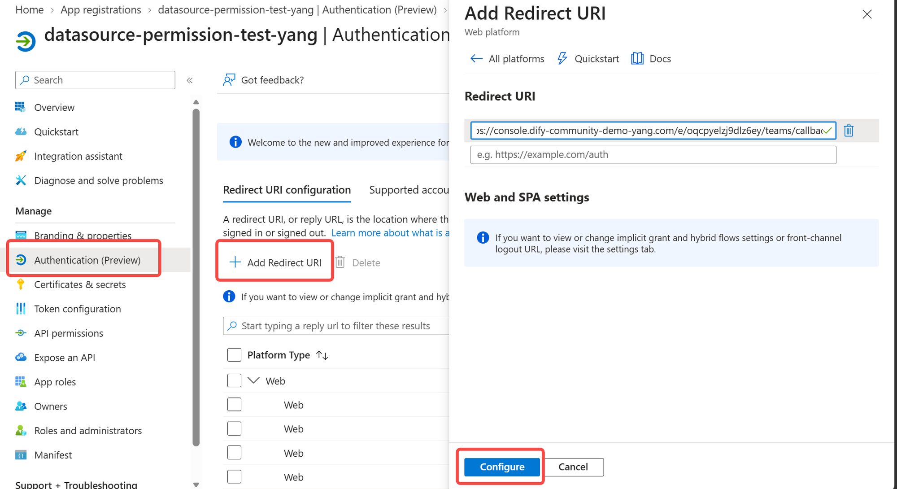
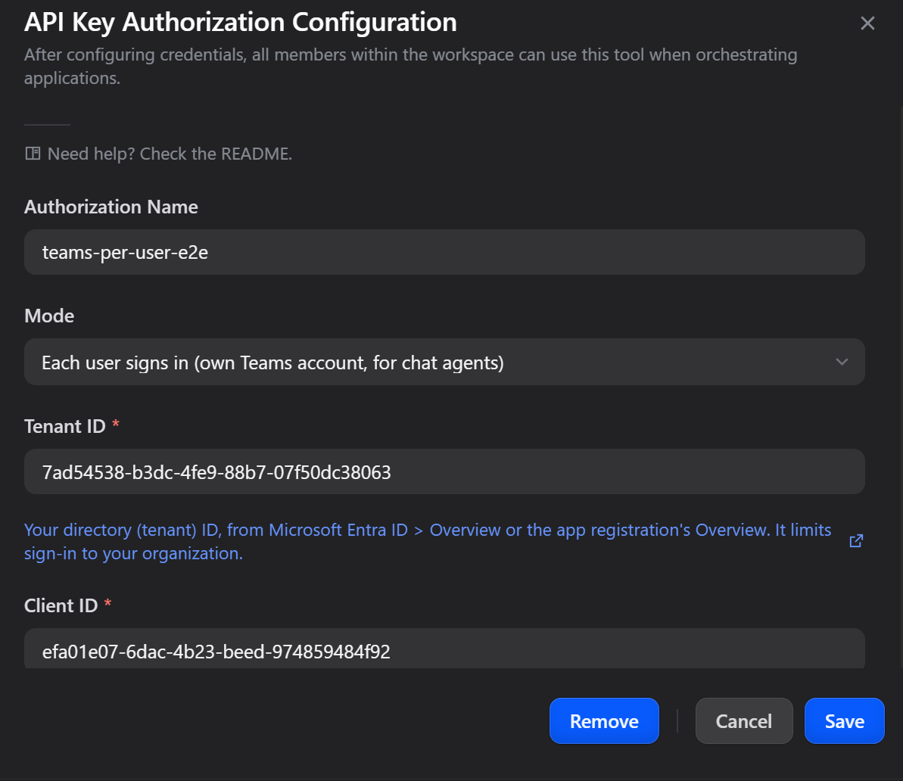
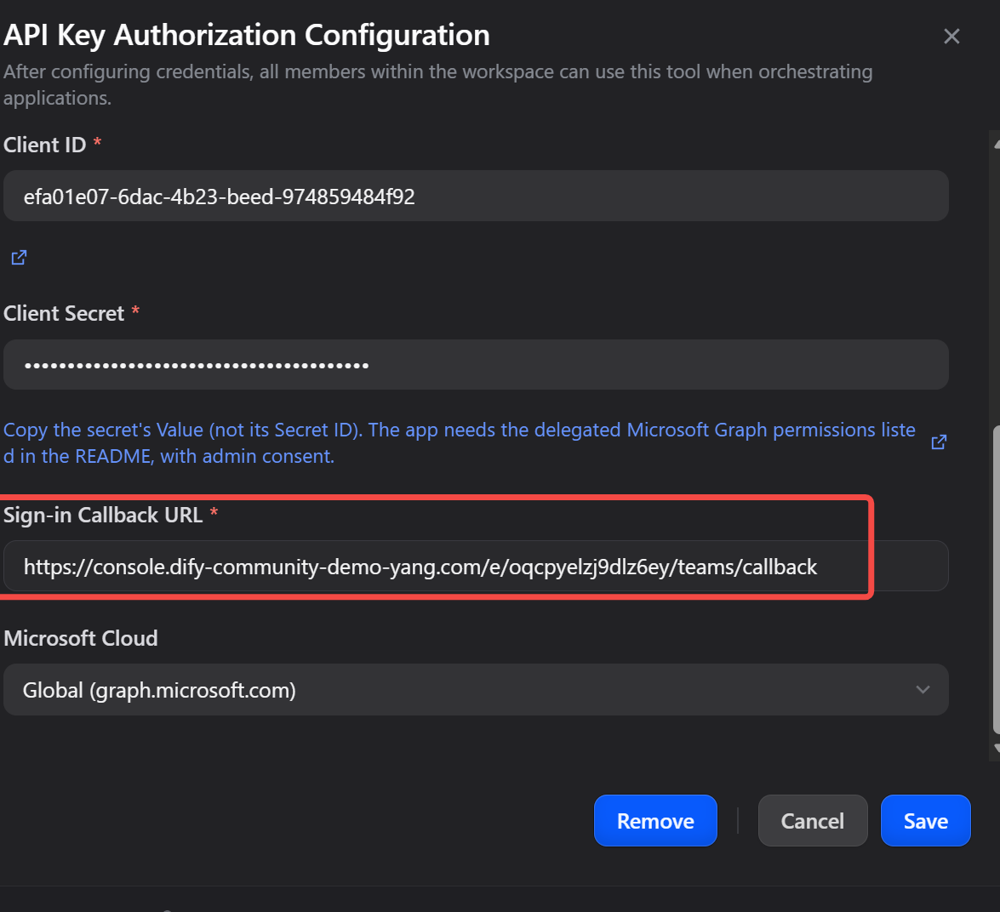
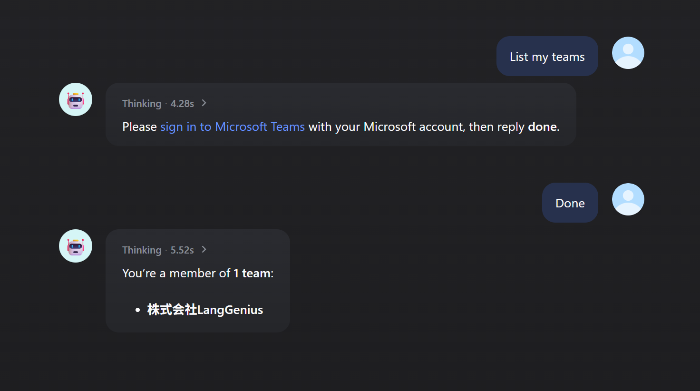
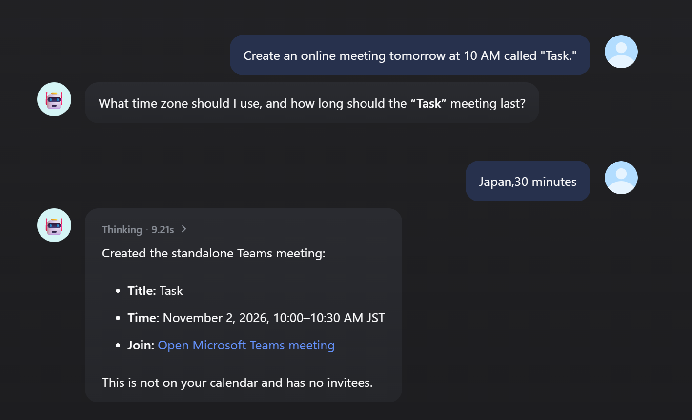
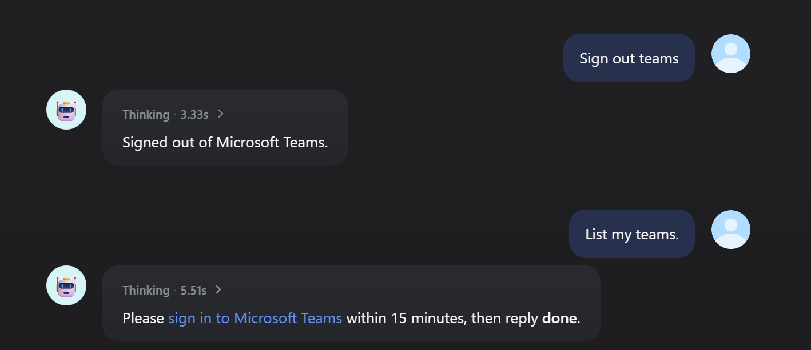

# Microsoft Teams

**Author:** langgenius
**Type:** tool

## Overview

Post and reply to messages in Microsoft Teams **channels** and **chats**, start chats, create online meetings, and manage **Planner** tasks — via the Microsoft Graph API with OAuth2. Works in the global cloud and in national clouds (US Government, China/21Vianet).

## Choose how to authorize

| Mode | Who the tools act as | Use it for |
|---|---|---|
| **OAuth** | The one person who signed in from the Dify console; everyone using the tool shares that account | A workflow or app that posts as one known account |
| **Each user signs in** (new in 1.0.0) | Whoever is chatting with the agent; each user signs in once with their own Microsoft account | A chat agent that many people use ("what did my team post today?", "set up a meeting with Kim") |

Both use the same app registration and can exist side by side; pick one per agent or workflow node. Teams has no app-only (Service Principal) mode: Microsoft Graph does not let app-only tokens post messages or read chats.

## Tools

- **List Teams** — the teams you belong to (`GET /me/joinedTeams`).
- **List Channels** — channels in a team (`GET /teams/{team-id}/channels`).
- **Send Channel Message** — post a message to a channel (`POST /teams/{team-id}/channels/{channel-id}/messages`).
- **Send Chat Message** — post a message to a 1:1 or group chat (`POST /chats/{chat-id}/messages`).
- **List Chats** — your chats with their participants (name, user ID, email), a display name (the topic, or the other participants) and web link. Filter by an exact participant name and/or email and by chat type (one-on-one, group, meeting); reads several pages and returns `pagination.next_link` to continue (`GET /me/chats?$expand=members`).
- **List Chat Messages** (new in 0.2.0) — the messages of a chat, newest first, by created or last-modified time with an optional time window; system events are left out unless asked for (`GET /chats/{chat-id}/messages`).
- **List Channel Messages** — recent messages in a channel.
- **List Group Calendar Events** — events from a team's Microsoft 365 group calendar, optionally within a start/end date range (`GET /groups/{team-id}/calendarView`); returns subject, start/end, organizer, attendees and Teams meeting info.

### Channel threads (new in 0.2.0)
- **Reply to Channel Message** — reply in a message's thread (`POST …/messages/{message-id}/replies`).
- **List Channel Message Replies** — the replies in a thread.

### Chats (new in 0.2.0)
- **Create Chat** — start a one-on-one or group chat with users given by UPN or user ID; the signed-in user is added automatically, and an existing one-on-one chat is returned instead of a duplicate.
- **List Chat Members** — members of a chat (names, emails, user IDs).

### Online meetings (new in 0.2.0)
- **Create Online Meeting** — a standalone Teams meeting with its join link (`POST /me/onlineMeetings`). Times are ISO 8601; a value without a UTC offset is taken as UTC.
- **Get Online Meeting** / **Delete Online Meeting** — by meeting ID.

### Planner (new in 0.2.0)
- **List Planner Plans** — plans of a team.
- **List Planner Buckets** — buckets (columns) of a plan.
- **List Planner Tasks** — tasks of a plan, optionally without completed ones.
- **Create Planner Task** — with bucket, due date and assignees (user IDs, or `me`).
- **Update Planner Task** — title, bucket, progress (`percent_complete`: 0 / 50 / 100) or due date.
- **Delete Planner Task**.

### Account (new in 1.0.0)
- **Sign Out of Teams** (`teams_sign_out`) — *Each user signs in* only: forget the current user's Teams sign-in, for switching accounts. Other plugins (for example Outlook) keep their own sign-in.

Typical flows: **List Teams** → **List Channels** → **Send Channel Message** / **Reply to Channel Message**; **List Teams** → **List Planner Plans** → **Create Planner Task**.

## Setup (Azure AD app + OAuth2)

1. In the [Azure Portal → App registrations](https://portal.azure.com/#view/Microsoft_AAD_RegisteredApps/ApplicationsListBlade), register an application.
2. Copy the **Application (client) ID** and, under **Certificates & secrets**, create a **client secret**.
3. Under **API permissions** → **Add a permission** → **Microsoft Graph** → **Delegated permissions**, add the 11 permissions below. The search box matches the start of a permission's name, and none is called "Teams": search for the text in the second column.

   | Permission | Search for | Used by |
   |---|---|---|
   | `Team.ReadBasic.All` | `Team.` | List Teams |
   | `Channel.ReadBasic.All` | `Channel` | List Channels |
   | `ChannelMessage.Send` | `ChannelMessage` | Send Channel Message, Reply to Channel Message |
   | `ChannelMessage.Read.All` (admin consent required) | `ChannelMessage` | List Channel Messages, List Channel Message Replies |
   | `Chat.ReadWrite` | `Chat` | List Chats, List Chat Messages, Create Chat, List Chat Members |
   | `ChatMessage.Send` | `ChatMessage` | Send Chat Message |
   | `Group.Read.All` (admin consent required) | `Group.Read` | List Group Calendar Events |
   | `OnlineMeetings.ReadWrite` | `OnlineMeetings` | Create / Get / Delete Online Meeting |
   | `Tasks.ReadWrite` | `Tasks` | Planner tools |
   | `User.Read` | `User.Read` | Signing in (usually already there) |
   | `offline_access` | `offline` | Staying signed in |

   Then click **Grant admin consent for \<your organization\>**: every row should show a green *Granted*. Two of the permissions require it, and with *Each user signs in* it also spares every user a consent screen. Teams needs no **Application** permissions; if the app registration is shared with other plugins, their permissions can stay.
4. Add the redirect URI shown by Dify when you connect the plugin.
5. In Dify, configure the plugin with **Client ID**, **Client Secret**, (optional) **Tenant ID** — leave it blank / `common` for personal or multi-tenant apps — and **Microsoft Cloud** (Global unless your tenant is in a national cloud), then complete the OAuth sign-in.

## Each user signs in (for chat agents, new in 1.0.0)

The first time a user needs Teams, the tool returns a Microsoft sign-in link instead of data; the agent passes it on, the user signs in in the browser, comes back and says they are done, and the agent calls the tool again. From then on the tools act as that user, in later conversations too.

1. In the app registration, add the **delegated** permissions listed above and click **Grant admin consent** (several of them need it, and users then never see a consent screen).
2. In Dify, open the Teams plugin's details → **Endpoints**, click **+**, enter a name (nothing else to fill in), and copy the endpoint URL with the copy button. It looks like `https://<your-dify-domain>/e/<id>/teams/callback`.

   

   If it starts with `http://localhost`, your self-hosted Dify still uses the default `ENDPOINT_URL_TEMPLATE=http://localhost/e/{hook_id}`: set `ENDPOINT_URL_TEMPLATE=https://<your-dify-domain>/e/{hook_id}` in `docker/.env` and restart the API (`docker compose up -d api`), or replace `http://localhost` with your Dify address by hand. Microsoft accepts `http` only for `localhost`.
3. In the app registration, open **Authentication** → **Add Redirect URI** → **Web**, paste the endpoint URL and click **Configure**. A mismatch shows up later as error `AADSTS50011` on the Microsoft sign-in page.

   

4. In the Teams plugin's details, click **Add API Key**, keep **Mode** at *Each user signs in*, and fill in **Tenant ID**, **Client ID** and **Client Secret** from the app registration (copy the secret's *Value*, not its Secret ID).

   

   Then paste the endpoint URL into **Sign-in Callback URL** (Dify rejects a `localhost` URL) and keep **Microsoft Cloud** at *Global* unless your tenant is in a national cloud. On save, Dify checks the fields and, with a specific tenant ID, that Microsoft accepts the client ID and secret; no user's data is read and no user token is stored in the authorization.

   

5. In the agent, add **Microsoft Teams** under **TOOLS**, keep the tools you want and **Sign Out of Teams**, and choose this authorization in the credential menu next to Teams. If the menu shows an OAuth authorization instead, the tools act as that one shared account and no one is asked to sign in. Instructions like these work well:

   ```
   You can use the Microsoft Teams tools on behalf of the current user.
   - If a tool says the user needs to sign in and returns a link, give the link to the user exactly as returned. Ask them to open it, sign in with their own Microsoft account, and reply "done" when finished. After they reply, call the same tool again.
   - Before posting a message, creating a chat or meeting, or changing a Planner task, tell the user what you are about to do.
   - Never make up messages or data. If a tool returns an error, tell the user what it says.
   - If the user asks to sign out or switch accounts, call teams_sign_out.
   ```

### What users see

1. The first Teams request returns a sign-in link, valid for 15 minutes. The user signs in with their own Microsoft account; a page titled **Signed in** asks them to go back to the chat (and to cancel if someone else sent them the link). They reply "done" and get the answer.

   

2. From then on the tools act as that user, for example creating a Teams meeting with its join link.

   

3. "Sign out of Teams" forgets their Teams sign-in; the next Teams request asks them to sign in again.

   

### With Outlook in the same agent

Outlook (1.0.0 and later) has the same *Each user signs in* mode. Each plugin keeps its own sign-in: a user signs in once for each, and signing out of one leaves the other signed in. With one app registration for both and admin consent, the second sign-in usually needs no password: the browser is already signed in to Microsoft, so the user only picks their account. Teams meetings are events in the Outlook calendar, so questions about the user's meetings belong to Outlook's calendar tools; this prompt routes requests between the two:

```
You can use the Outlook and Microsoft Teams tools on behalf of the current user, with their own Microsoft account.

Which tools to use:
- Schedule, meetings (including Teams meetings) and free time: Outlook calendar tools (list_events, search_events, get_schedule). Teams meetings are events in the Outlook calendar; list_events and search_events already show each event's location and join link, so do not open events one by one to check that.
- Email: Outlook mail tools (list_messages, get_message). Create a draft instead of sending unless the user clearly asks you to send.
- Teams, channels, chats and channel messages: Teams tools (list_teams, list_channels, list_chats, ...).
- A new Teams meeting link without a calendar invitation: create_online_meeting. To invite people, create a calendar event with an online meeting instead (create_event).

Sign-in:
- Outlook and Teams each have their own sign-in. If a tool says the user needs to sign in and returns a link, give the link to the user exactly as returned, ask them to open it, sign in with their own Microsoft account and reply "done", then call the same tool again.
- If the user asks to sign out or switch accounts, call outlook_sign_out for Outlook and teams_sign_out for Teams (both if they don't say which).

Rules:
- Before posting a message, creating a chat, meeting or event, or changing a task, tell the user what you are about to do.
- Never make up emails, events or messages. If a tool returns an error, tell the user what it says.
```

How it works and what to know:
- Each user's tokens are kept in the plugin's storage, encrypted with a key derived from the client secret. They never reach the agent or the logs. The endpoint only holds a one-time authorization code briefly; turning it into a token also needs the client secret and a PKCE verifier it never sees.
- Users stay signed in while they keep using it (the access token is renewed hourly; Microsoft's refresh token expires after about 90 days unused). They sign in again after signing out, a password change, an administrator revoking their sessions, or a client secret rotation.
- Users are told apart by Dify's user ID. It is stable in the console and for Service API callers that always send the same `user`; in a public web app without login, each browser is a new anonymous user. The Service API `user` value is chosen by the caller, so call the API only from a trusted backend.
- A user could send their own sign-in link to a colleague, whose account would then be connected to the sender's chat. The **Signed in** page warns about this and offers to cancel; an administrator can end any connection by revoking the user's sessions in Entra.

> Upgrading from 0.1.x: 0.2.0 asks for three more delegated permissions (`ChannelMessage.Read.All`, `OnlineMeetings.ReadWrite`, `Tasks.ReadWrite`). Add them to the app registration, grant consent, and re-authorize once. Existing authorizations keep working for the 0.1.x tools in the meantime.

## Notes

- Auth uses delegated permissions, so messages are posted **as the signed-in user** (the OAuth account, or with *Each user signs in*, the user chatting with the agent).
- Access tokens are refreshed automatically via the stored refresh token (`offline_access`).

## Output variables

Besides `text` and `json` (unchanged), every tool returns typed variables that later workflow nodes can pick directly, without parsing `json`. Every tool has `success` (boolean) and `error` (string, empty on success), so a workflow can branch with an IF node; list tools return an array of flat items plus `count`.

| Tool | Variables (besides `success`, `error`) |
|---|---|
| List Teams | `teams`, `count` |
| List Channels | `channels`, `count` |
| Send Channel Message | `message_id`, `web_url`, `created_datetime` |
| Send Chat Message | `message_id`, `web_url`, `created_datetime` |
| List Chats | `chats`, `count`, `has_more`, `next_link` |
| List Chat Messages | `messages`, `count`, `has_more`, `next_link` |
| List Channel Messages | `messages`, `count` |
| List Group Calendar Events | `events`, `count` |
| Reply to Channel Message | `message_id`, `web_url`, `created_datetime` |
| List Channel Message Replies | `replies`, `count` |
| Create Chat | `chat_id`, `chat_type`, `web_url` |
| List Chat Members | `members`, `count` |
| Create Online Meeting | `meeting_id`, `subject`, `join_url`, `start`, `end` |
| Get Online Meeting | `meeting_id`, `subject`, `join_url`, `start`, `end` |
| Delete Online Meeting | `meeting_id` |
| List Planner Plans | `plans`, `count` |
| List Planner Buckets | `buckets`, `count` |
| List Planner Tasks | `tasks`, `count` |
| Create Planner Task | `task_id`, `title`, `bucket_id`, `percent_complete`, `due_datetime` |
| Update Planner Task | `task_id`, `title`, `bucket_id`, `percent_complete`, `due_datetime` |
| Delete Planner Task | `task_id` |
| Sign Out of Teams | `signed_out` |

## Privacy

See [PRIVACY.md](PRIVACY.md).
