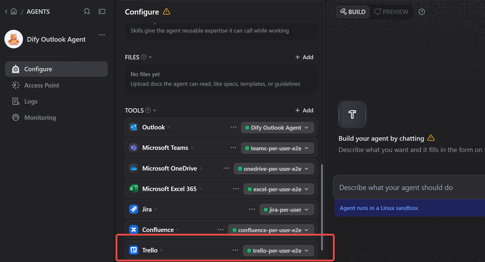
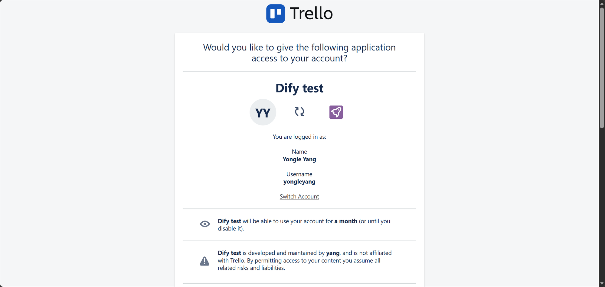
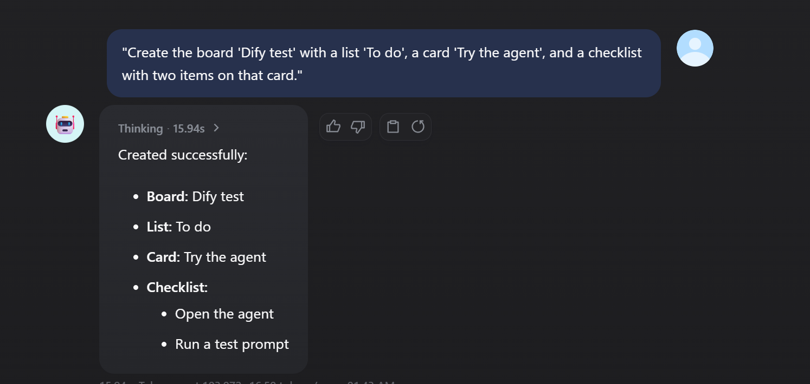

# Trello

Trello: A visual tool for organizing your work and life.

Work with boards, lists, cards, comments, checklists, labels, members and attachments from Dify agents and workflows.

## What's new in 1.0.0

- **Each user signs in**: in a chat agent, every user works in Trello as themselves.
  - The first time someone needs Trello, the agent gives them a Trello link.
  - After they click **Allow**, the tools act with that person's own boards and permissions.
- **29 new tools**: search, cards, comments, checklists, labels, lists, board members and attachments.
- **Output variables**: the new tools return typed output variables (and `success` / `error`) for workflows.
- **`update_card_by_id`**: also takes the due date, due-complete, archived, position, members and labels.
- **Security**: the API key and token are now sent in the `Authorization` header instead of the URL, so they no longer end up in proxy or server logs.

Existing API key + token credentials keep working unchanged.

## Tools

| Area | Tools |
|---|---|
| Find | `trello_search`: free text and Trello search operators (`@me`, `due:week`, `is:open`, `label:bug`…) |
| Boards | `fetch_all_boards`, `get_board_by_id`, `create_board`, `update_board_by_id`, `delete_board`, `get_board_actions` |
| Lists | `get_lists_from_board`, `create_list_on_board`, `trello_update_list` (rename, archive, reorder, move to another board), `trello_get_list_cards` |
| Cards | `trello_get_card` (with checklists, members, attachments), `get_board_cards`, `get_filtered_board_cards`, `create_new_card_on_board`, `update_card_by_id`, `delete_card_by_id` |
| Comments | `trello_list_comments`, `trello_add_comment`, `trello_update_comment`, `trello_delete_comment` |
| Checklists | `trello_list_checklists`, `trello_create_checklist` (with items), `trello_delete_checklist`, `trello_add_checklist_item`, `trello_update_checklist_item` (tick / untick / rename), `trello_delete_checklist_item` |
| Labels | `trello_list_labels`, `trello_create_label`, `trello_update_label`, `trello_delete_label`, `trello_add_card_label`, `trello_remove_card_label` |
| Board members | `trello_list_board_members`, `trello_add_board_member`, `trello_invite_board_member` (by email), `trello_remove_board_member` |
| Attachments | `trello_list_attachments`, `trello_add_attachment` (a file, text plus a file name, or a link), `trello_get_attachment` (returns the file, up to 50 MB), `trello_delete_attachment` |
| Sign-in | `trello_sign_out` (Each user signs in only) |

## Setup

Both modes start with an API key from the [Trello Power-Up admin portal](https://trello.com/power-ups/admin):
1. Click **New** and fill in the form to create an integration.
2. Open its **API key** tab and click **Generate a new API key**.
3. Note the **API key**. For Each user signs in, also note the **Secret**.

### API key + token (everybody uses one account)

1. Next to the API key, click the **Token** link and allow access to get a token.
2. In Dify, open the plugin's authorization and keep **Mode: API key + token**.
3. Enter the **Trello API key** and **Trello API token**.

### Each user signs in (for chat agents)

1. Open the plugin's details › **Endpoints** and create an endpoint (no settings). Copy its URL ending in `/trello/callback`.
   - If it starts with `http://localhost`, set `ENDPOINT_URL_TEMPLATE` on the Dify API service to your public address, e.g. `https://dify.example.com/e/{hook_id}`.
2. In the Power-Up admin portal › your integration › **API key**, add the URL's origin (e.g. `https://dify.example.com`) to **Allowed origins**. Trello only sends users back to allowed origins.
3. In Dify, add a credential:
   - **Mode**: *Each user signs in*. If you leave Mode on *API key + token* but fill in the callback URL and no token, the plugin still uses Each user signs in.
   - **Trello API key** and **API Secret**. The secret is only used to encrypt the stored sign-ins.
   - **Sign-in Callback URL**: the endpoint URL.
   - **Sign-in Lasts**: 1 day, 30 days (default) or until revoked.
4. Add the Trello tools to a chat agent with this credential.

   

**What users see**:
1. The agent replies with a Trello link.
2. The user opens it, checks the account and clicks **Allow**.
3. The page shows *Signed in*. Back in the chat, the user says they are done.
4. The agent continues and says which Trello account was connected.

**Signing out and signing in again**:
- Asking the agent to sign out of Trello (`trello_sign_out`) forgets the user's sign-in.
- When the sign-in expires or the user revokes it (Trello › Settings › Applications), the next request returns a new link.

## How the sign-in is protected

Trello has no authorization-code flow. Its Allow page hands the token to the browser in the URL fragment, which never reaches a server. The callback page's script posts the token back to the plugin's endpoint. To keep the token safe along the way:

- **Sealed in transit**: for each sign-in, the tool creates a one-time key pair. The endpoint seals the token with the public key, and only the tool, which keeps the private key in the user's encrypted record, can open it. Plugin storage never holds a readable token.
- **Encrypted at rest**: stored per-user tokens are encrypted with a key derived from the API secret, and never appear in tool output, logs or URLs.
- **One use per link**: each sign-in link works once and for 15 minutes.
- **Forwarded links**: the page warns people who did not start the sign-in and lets them cancel it.
- **Path safety**: IDs are URL-encoded, so a value chosen by the model cannot change which API is called.

## Troubleshooting

| Message | Fix |
|---|---|
| `Invalid return_url. The return URL should match the application's allowed origins.` | Add the callback URL's origin (e.g. `https://dify.example.com`, no path, no trailing slash) to the API key's **Allowed origins**. |
| *Sign-in not completed* on the callback page | The user did not click **Allow**. Ask the agent again for a new link. |
| `Trello API error 401` with API key + token | The token was revoked or has expired. Generate a new one. |

## Privacy

See [PRIVACY.md](PRIVACY.md).
